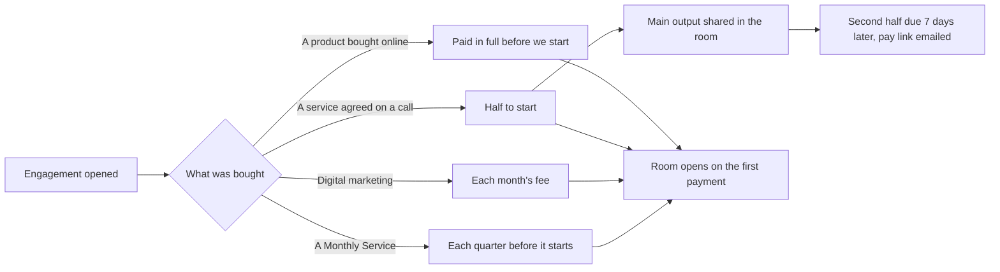
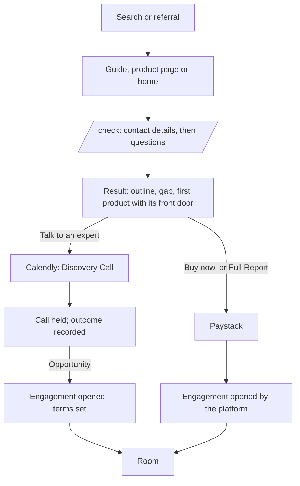

# 3. App flow

**How The Shift works for each person who uses it, step by step.** Rebuilt on 8 November 2026 from the
[PRD](01-prd.md) review, as service blueprints: for every step, what the client does, what the platform does on its own,
what a person on the team does, the email that goes out, and the status that changes. Each step says whether it is
**Built** or **To build** (with the PRD requirement, R1 to R73). The [coverage matrix](09-coverage-matrix.md) checks this document against the code. Diagrams use Mermaid, which GitHub renders.

How to read it. Sections 1 to 4 are the design: who arrives where, the two rules that shape everything after (the
front doors and the payment terms), and the journeys. Sections 5 to 7 are the reference for building and testing: every
status, every email and every exception. Section 8 maps the pages, the admin console and the room as they are today.
`test/docs/productDocs.test.ts` fails if a route is added to `client/src/App.tsx` without appearing here.

**The rule for this document (ET, 8 November 2026):** nothing is built before it is described here and in the PRD. A
new need changes this document first.

---

## 1. Who arrives, and where

| Arrives as | Usually from | Lands on | Wants | Leaves through |
|---|---|---|---|---|
| **Searcher** | Google: a problem ("how to price my products in Nigeria"), a product ("business plan writer Lagos price") or the firm's name | A guide (`/guides/:slug`), a product page (`/services/:slug`) or the home page (`/`) | To know whether we can fix it, what it costs, and whether we can be trusted | One of the two front doors (section 2): **Buy now** or **Talk to an expert**; or the free check |
| **Referral** | A WhatsApp message, a past client, Enzo Krypton & Co. | The home page, a product page or `/contact` | To talk to someone | **Talk to an expert** (a call or WhatsApp) |
| **Check taker** | Any page | `/check` | A free reading of what holds the business back | The result: the first product with its front door, the Full Report, or a call |
| **Client** | The invitation, a sign-in link, a payment or reminder email, a bookmark | `/dashboard` (the room) | Where the work stands, what is needed from them, what to pay | The room's next action |
| **IP Factory staff** | `/admin/login` | `/admin` | Their projects, the pipeline, the money | Their tab in the admin console (section 8.3) |

## 2. The two front doors

Every page that sells ends in one of two doors, chosen by the product (`buy` in `shared/products.ts`). Both open the
same kind of engagement, so everything after the door works the same way.

| | **Buy now** | **Talk to an expert** |
|---|---|---|
| For | Fixed-price products a client can scope alone: the Full Report, the Funding Readiness Assessment, Strategy and 90-Day Plan, Business Model, Financial Model, Pitch Deck, Bookkeeping Catch-Up, 13-Week Cash Flow Forecast, Hiring Toolkit | The Business Review, Business Plan, Pricing and Unit Cost Review, Funding Application Pack, the Six-Week Fix, the Monthly Services, Digital Marketing |
| The buyer does | Gives name, business, email and WhatsApp; pays on Paystack | Books a 20-minute Discovery Call, or messages on WhatsApp |
| Then | The platform opens the engagement, invites the owner and shows what happens next | The lead opens the engagement; its payment terms follow what was bought (R36) |
| Payment terms | Paid before we start | Half to start and half on delivery for a service; month by month for Digital Marketing; a quarter at a time for a Monthly Service (R36) |
| Status | **To build (R13).** Online ordering is off today (`ONLINE_ORDERS_OPEN`): every Buy-now product shows Talk to an expert until R13 ships. The Full Report is the exception and is bought from the check today | **Built** (Calendly, then New engagement) |

**On every page with a door (R38, partly built):** the expert behind the work by name, the office address, "Talk to an
expert on WhatsApp", what happens after paying, the Terms. Today the Terms link and the Calendly call are there; the
named expert, the WhatsApp line and the "what happens next" block are to build.

## 3. Payment terms, and when the room opens

Payment terms follow what is bought (ET, 10 November 2026, R36), so no engagement's terms are negotiated one by one.

| What is bought | When it is paid | Fee dates |
|---|---|---|
| A product bought online (the Full Report, a readiness assessment, a Done for You piece bought without a call) | In full, before we start | The start date |
| A service agreed on a call: the Business Review, the Business Plan, the Pricing and Unit Cost Review, the Funding Application Pack, the Six-Week Fix | Half to start, half on delivery (the Six-Week Fix too; paying in full at the start still saves 5%) | Half on the start date; the second half seven days after the main output is shared: the Findings of a Business Review, the result of a Six-Week Fix (Your Plan), the finished work of a Done for You service |
| Digital marketing | Each month's fee | Day 0, 30 and 60 from the kickoff; paid in arrears, day 30, 60 and 90 (R74) |
| A Monthly Service | A quarter at a time, before the quarter starts | The start of each quarter |

The room opens on the first payment (built, R11). Only a Partner or the Super Admin can open it sooner, or move the
first fee past the start date before anything is paid (`approve_work_before_payment`); each is recorded. **Paid in
arrears (R74)** is the third such choice, for Digital Marketing: on the engagement's Fees, a Partner or the Super Admin
sets the kickoff date and chooses **Pay in arrears**. Each month's fee then falls due 30, 60 and 90 days after the
kickoff, its label says so, and the room opens at once. A new kickoff date moves every fee not yet paid; **Pay in
advance** puts the days back to 0, 30 and 60 and the labels back to the standard ones. Each change is recorded. Finance counts
every unpaid fee as owed, and a fee as late once its date passes unpaid. A second half has no date until delivery, so it is owed but cannot be late. Work pauses seven days
after a missed date (D6, R51): the room says so from the first late day, and the team sees **Fee late**, then **Paused**
(built, E5); the emails, telling the client at three days, come with reminders (R12).

Today's clients: **Marcelle (Digital marketing)** pays at 30, 60 and 90 days from her kickoff, as agreed with her; her
lead sets those dates by hand in the engagement's Fees (I4).

**The Digital Marketing rhythm (R77, ET 11 November 2026, from the Crown Studio agreement).** The kick-off questions
come first, as a Data Request answered before the kick-off. Then every week: the client sends footage by Thursday, the
Content Producer edits within 48 hours, the Digital Marketer shares the next week's pieces for approval on Saturday, and
the client approves or asks for changes by Monday (two rounds per piece). Weekly Check-ins in month 1, a Check-in every
two weeks after; a review at the end of each month, the Month 2 review asking whether to continue. Each month's content
plan is shared for approval, and the Google Business Profile has its own assessment and growth plan. A piece counts
towards the month once it is published.

### 3.1 Recording money: the ledger (R37, batch F; approved by ET on 10 November 2026)

**Built (F1, 10 November 2026):** paying online for what is left, recording money by hand in part or in full, cancelling a
payment recorded by mistake, accepting a payment that needs a look, receipt and invoice numbers, and fees saved in
place (live 10 November 2026). **Built (F2):** refunds against a payment, cancelling a refund recorded by mistake,
and write-offs with their reversal. **Built (F4):** Finance from one source: money in from the payments, with test
payments apart, each payment opening to its fee and its Paystack reference (section 4.7).

Every naira that comes in is one **payment** against one fee: a Paystack transaction, or money that came another way
and was recorded by hand. The Business Review is a fee since F3 (section 3.2); until the Full Report becomes an order
(R13), its payment is against its payment request, as is the payment of a Business Review link sent before F3. Finance reads money in from the payments and money owed from the fees (built, F4), so every
naira traces to one fee and one Paystack reference, or to the person who recorded it. Nothing about money is deleted: a
payment recorded by mistake is cancelled, a refund is recorded against the payment it returns, and a write-off can be
reversed; each keeps who did it, when and why.

| Action | Who | What it asks for | What changes | Email |
|---|---|---|---|---|
| Pay online, from the fee's pay page or the room | The owner, or anyone with the fee's link | — | A payment is **Started** for what is left on the fee; Paystack's confirmation makes it **Paid**, with the next receipt number | Owner: *Payment received: {fee}*, with the receipt number and anything left to pay. Office: *Paid online: …* |
| Record a payment by hand | Finance or the Super Admin (`manage_payments`) | The amount (no more than is left; part of it is fine), the day it arrived (not in the future), how it came (bank transfer, cash or other) and a note, such as the bank's reference | A **Paid** payment, with the next receipt number and who recorded it. The first payment opens a room that waited for it, as today | Owner: *Payment received: {fee}* |
| Cancel a payment recorded by hand by mistake | Finance or the Super Admin | A reason | The payment is **Cancelled**: it stays on the record with its receipt number, marked cancelled, and no longer counts, so its amount is owed again | Owner, if a receipt went out: *Your payment record has been corrected: {fee}* |
| Accept a payment that needs a look | Finance or the Super Admin | — | It counts as **Paid**, with a receipt number. Only what fits: if it is more than is left, the difference is refunded and recorded first | Owner: *Payment received: {fee}* |
| Record a refund, once the money has gone back through Paystack or the bank | Finance or the Super Admin | The amount (no more than the payment, less earlier refunds), the day, the reason and Paystack's or the bank's reference | The refund is kept against its payment, and that amount is owed again unless it is written off. Refunded in full, the payment shows **Refunded** | Owner: *Your refund: {fee}* |
| Cancel a refund recorded by mistake | Finance or the Super Admin | A reason | The refund stays on the record, marked cancelled, and no longer counts | — |
| Write off what is left of a fee | A Partner or the Super Admin (`write_off_fees`) | A note saying why | The fee is **Written off**: nothing more is owed, it is never late and it never pauses the work. The client sees *Nothing more to pay* | None: the Partner tells the client |
| Reverse a write-off | A Partner or the Super Admin | A reason | What was written off is owed again | — |

The engagement team's **Paid** tick is gone: it could open a room or lift a pause without the money. Only Finance and
the Super Admin record money (ET, 10 November 2026), in line with the 6 November rule that recording payments stays with
`manage_payments`; the team sees each payment, and tells Finance when a client says they have paid another way.

**The rules.**

1. Paystack charges what is left on the fee when the checkout opens, so a part-paid fee is finished online. If a payment
   recorded by hand lands while a checkout is open, the Paystack payment that no longer fits **needs a look**.
2. A fee's amount cannot go below what is paid on it. Raising a fee that was paid in full makes it part paid again, and
   the owner is told (*Your fees have changed*).
3. A fee that has been billed cannot be removed: it is changed, or a Partner writes it off. A fee is billed, and gets its
   invoice number, the first time its pay link is emailed or a payment is started or recorded against it.
4. Cancelling a payment or recording a refund makes that amount owed again. If the fee's date has passed it is late
   again, and the work can pause (D6). A cancelled payment never closes a room it opened.
5. A write-off covers what is left at that moment, so a later refund on the fee is owed again unless it is written off
   too. A written-off fee cannot be changed until the write-off is reversed. A write-off never opens a room:
   **Open the room now** does.
6. A Paystack payment is never cancelled, because the money moved: it is refunded.
7. Each payment received gets the next receipt number (`TS-RC-000001`) and each billed fee the next invoice number
   (`TS-IN-000001`): unique, in order and without gaps, ready for the PDFs of R53.
8. The team's Fees and Finance show each fee's payments and refunds: receipt number, day, how, amount and who recorded
   it. The client's Payments tab shows each fee's state, what is left with **Pay**, and the receipt number, day and
   amount of each payment and refund; never a cancelled one, a note or who recorded it.

### 3.2 The Business Review on fees (R37, batch F3)

**Built (F3, 10 November 2026).** The Business Review is paid like any fee, so every naira of it traces to its fee and
one Paystack reference.

1. **Sending the link** (Pipeline, the check's record, Payments, Business Review: **Send the payment link**;
   `manage_payments`, as before). The platform opens the client's Business Review engagement, waiting for its first
   payment, with the owner's name and email from the check, and its two fees at the server's price: **Business Review:
   half to start** (₦550,000), due two days later, the "pay by" day the email gives; and **Business Review: half on
   delivery** (₦550,000), with no date until the Findings are shared (section 3). Sending it bills the first half, so it
   gets its invoice number. The owner is emailed *Payment details for your Business Review* with the fee's pay link. A
   check before Opportunity moves to Opportunity, as before. Sending it again emails the same fee's link: it never opens
   a second engagement, and a paid first half cannot be sent again.
2. **Paying it.** The owner pays on the fee's pay page, like any fee; money that came another way is recorded on the
   fee by Finance (section 3.1). The first payment opens the room and starts the Business Review: the check moves to
   **Won**; the Work Plan, Data Request and Sessions load, dated from that day; and the owner is invited to their client
   account, unless an invitation is out or they have one. The owner gets the receipt (*Payment received: Business Review:
   half to start*, with the receipt number and what happens next), then the invitation.
3. **Before it is paid**, nothing is due from the client, so the engagement holds only its fees. The team sees it in
   Engagements as **awaiting first payment**. A Partner or the Super Admin can **Open the room now**: the plan loads and
   the owner is invited (the reason is recorded with the invitation); the check moves to Won when the money comes.
4. **If the owner does not go ahead**, the first half stays owed and shows as late in Finance after its date; it never
   pauses work, because the room is waiting for it. A Partner writes it off with a note, and the team moves the check
   to Lost or Nurture.
5. **Links sent before F3** stay as they were: a Business Review payment request keeps its pay page until its 48 hours
   pass, and a paid one keeps its engagement, its receipt and its history. Sending the link again opens the engagement
   on fees, and from then on the old link no longer takes payment, nor can it be confirmed by hand: money for it is
   recorded on the fee. The Full Report stays a payment request, recorded in the ledger with its receipt number (F1),
   until orders arrive (R13).

## 4. The journeys

Columns: **Client** does · **Platform** does on its own · **Team** does · **Email** (to whom) · **Status** after · **Built?**

### 4.1 Prospect to client, by the free check (Built)

| # | Client | Platform | Team | Email | Status | Built? |
|---|---|---|---|---|---|---|
| 1 | Gives name, email, WhatsApp, how they heard; "Start the check" | Saves a lead before any business question | — | — | Pipeline **Lead** | Built |
| 2 | Answers one question per screen (about 30 at most; the path depends on the answers) | Saves on the device and the server about once a second; resumes where they stopped | — | — | — | Built |
| 3 | Sees the result: the outline (clear, watch, stuck), the gap, founder readiness, the first product and the next | Scores and routes by fixed rule; AI writes the summary only, checked against the catalogue | Reads the lead in Pipeline | Owner: the summary. Office: every answer | **Qualified lead** | Built |
| 3b | Neither books nor buys | Follows up on day 2 and day 7 with the guide for their stuck area and the first product with its front door; stops on a booking, a purchase or an unsubscribe | — | Owner: two follow-ups (to write) | Stays **Qualified lead**, or **Nurture** | To build (R48) |
| 4a | Buys the Full Report | Opens Paystack; on payment, emails the Report Intake link | — | Owner: *Payment received: your Full Report*. Office: *Paid online: …* | Payment **paid**; report **awaiting form** | Built |
| 4b | Answers the 17-question Report Intake | Builds the Full Report by fixed rule and emails the PDF at once | — | Owner: *Your Full Report: {business}* (PDF). Office: *Full Report sent* | Report **delivered** | Built |
| 5 | Books the Discovery Call in the embedded calendar | Records the booking only when Calendly confirms; picks up bookings made from the email | — | Office: *… asked for a free discovery call*. Calendly confirms to the owner | **Call booked** | Built |
| 6 | Joins the 20-minute call | — | Holds it; writes up the Discovery Call summary; records Opportunity, Refer, Lost or Nurture; shares the summary with the owner as a separate step | A Nurture outcome: one follow-up at day 30 (R48, to build) | **Opportunity**, **Referred**, **Lost** or **Nurture** | Built (the day-30 follow-up to build) |
| 7 | Pays the first half from the email's link, on the fee's pay page | Opens the Business Review engagement when the link is sent, waiting for its first payment, with both halves as fees; the first payment opens the room, moves the check to Won, loads the plan and invites the owner (section 3.2) | Opens the engagement (4.3), or for the Business Review sends the link for its first half (₦550,000 of ₦1,100,000); the second half falls due seven days after the Findings are shared (R36) | Owner: *Payment details for your Business Review*; then *Payment received: Business Review: half to start* and the invitation | Engagement **awaiting first payment**, then fee **paid** and check **Won** | Built (on fees, F3) |

### 4.2 Prospect to client, by Buy now (To build, R13 and R38)

| # | Client | Platform | Team | Email | Status | Built? |
|---|---|---|---|---|---|---|
| 1 | On a Buy-now product page: sees the price, the delivery date promise, the expert, WhatsApp; presses **Buy now** | — | — | — | — | To build |
| 2 | Gives name, business name, email, WhatsApp; ticks the Terms; pays on Paystack (card, transfer or USSD) | Opens Paystack for the catalogue price; never a price from the browser | — | — | Order **awaiting payment** | To build |
| 3 | Returns to "What happens next": the room link, the first records to send, a button to book the kickoff | On Paystack's confirmation: creates the business, the engagement (in advance), its fee (paid), its Data Request and Sessions from the product's intake; invites the owner | — | Owner: receipt; the invitation. Office: *New order: {product}, {business}* | Engagement **open**; fee **paid** | To build |
| 4 | Opens the room from the invitation or a sign-in link (R41) | — | The desk assigns the team (the office email is the prompt) | Team member: *You are on {business} as {role}* | — | To build (assignment built) |

### 4.3 Prospect to client, by a call (relationship)

| # | Client | Platform | Team | Email | Status | Built? |
|---|---|---|---|---|---|---|
| 1 | Agrees the work and the terms on the call | — | The lead opens **New engagement**: client (new or existing), type and service, start date | — | — | Built |
| 2 | — | Loads the type's Data Request, Work Plan, Sessions and fee schedule, dated from the start; invites the owner (an existing client's project joins their account) | Checks the fee schedule, whose terms follow what was bought (R36) | Owner: *Your The Shift room for {business}*, with **What we will do** (the work, the start date, each fee and its date; R47) | Engagement **open**; **awaiting first payment** | Built |
| 3 | Pays the first fee from the room or the email | Confirms the payment; opens the room; sends the receipt | Finance or the Super Admin records money that came another way (section 3.1), or a Partner uses **Open the room now** | Owner: receipt. Office: *Paid online: …* | Fee **paid**; room open | Built |

### 4.4 The client during delivery

| # | Client | Platform | Team | Email | Status | Built? |
|---|---|---|---|---|---|---|
| 0 | Opens the project for the first time | **Getting started**: the expert or experts with **WhatsApp {first name}**, the first three things to do (book the first Session, the first records, a fee due within seven days or late; one due later stays on Payments with its date), each linked to where it is done, and what happens next; **What we will do** sits beside the team. Getting started stays on Overview until the first Session is held | — | — | — | Built (R46, R47) |
| 1 | Opens the room: sees where things stand, the next action, the next Session | Shows one next action, chosen by rule: a fee the room waits for, approvals that hold up publishing, records past their date, records due this week, a Sign-off (R50) | — | — | — | Built (the rule to build, R50) |
| 2 | Books the kickoff and Sessions on Calendly from the room | Copies each booking's time and link onto the next Session without one, and emails the team the time and link with a calendar invitation (R75) | Holds the Session; saves client notes and internal notes; shares client notes the same day | Owner (and the people the notes are shared with): *Engagement update: {title}* | Session **held** | Built |
| 2b | Is emailed each meeting the team books, and sees it in the room; sees booked Sessions only (R81) | Reads the pasted Zoom invitation: the date and time, every date of a recurring meeting, the Join link; fills the plan's Session of that kind, else adds one; the same Zoom meeting pasted again moves it | **Book a meeting** in Sessions: the kind, Zoom's scheduler, Copy invitation, paste, check, send | Everyone: the Session emails (R75), or *Booked: {meeting}, N dates from {first}* for a recurring one | Session **planned**, with its time | Built (R81) |
| 3 | Sends records: uploads files and voice notes into the drop box; for raw video, pastes a Drive (or Dropbox, WeTransfer, iCloud) link, or presses **Send on WhatsApp to {name}** and marks it sent another way; or "Not available" with a note | Keeps files private; never stores raw video; reminds two days before an item's date and two days after it if still open | The person it is for (the Content Producer for footage) opens the link or the WhatsApp; matches each file to the items it answers; marks an item received or asks for more | Owner: reminders (to build). Lead: what is still outstanding after the reminders (to build) | Item **Sent, we are checking** → **Received**, **We need a bit more**, **Not available** | Files, voice notes and links built (R43); a client can take back a file until it is taken in (R61); WhatsApp to build (R44); reminders (R16) |
| 3b | Is asked for something by a team member (R78): *New request: {what}, due {day}*; in the room, the item with who asked, the brief and any document, and the day; sends it (a file, a link, **Mark as done**) or writes in its conversation | Emails each message to the other side; when it is sent, emails the person who asked and, for footage, starts the clock: the First edit within 48 hours of it arriving | The person who asked answers in the conversation; sees the hours left, or how late it is; presses **First edit shared** once the pieces are on the content board, which tells the owner | Owner: *New request: …*; *{name} wrote on {item}*; *Ready for your approval: the first edit of {item}*. Team: *Received from {business}: {item}*; *{business} wrote on {item}* | Item **To do** → **Sent, we are checking** or **Done**; clock **First edit due** → **First edit shared** | Built (R78) |
| 4 | Approves reels, posts and stories, or asks for changes (Digital marketing); on a phone, previews each piece and approves several at once | Counts the month's pieces once published (R77) | The Content Producer edits and sends for approval; the Digital Marketer plans and publishes | — | Content **For your approval** → **Approved** or **Changes requested** → **Published** | Built; previews and approving several at once to build (R54) |
| 5 | Reads a shared Deliverable; comments; gives Sign-off, or asks for changes (R51, to build) | — | Drafts; a lead approves prescriptions and plans; shares with the owner or the owner and their team; Specialists hand in drafts the lead shares | Owner: *Engagement update: {title}* | Deliverable **draft** → **approved** → **shared**; Sign-off given | Built |
| 6 | Sees the one number each week | Shows where it started, this week, where it is going | Records the weekly check-in: five questions, the reading, hours by role, AI used | — | — | Built |
| 7 | Pays each later fee from the reminder (by email, with its pay link) or the Payments tab; keeps the PDF receipt | Sends each fee's link 5 days before its date, on the day, and 3 and 7 days after if unpaid, in the morning run at 07:31 Lagos time, never between 9pm and 7am; confirms payment; sends the receipt and invoice as PDFs | Told at 7 days late; work pauses (D6) | Owner: *Coming up: {fee}, ₦{amount} due {day}*; *Due today: …*; *Now late: …*; *Work on your {engagement} is paused: {fee}*; receipt, invoice (PDFs to build). Lead: *Work paused: {business}, {fee}* | Fee **due** → **paid** (or **part paid**, section 3.1) or **late** | Built (reminders R12, 11 November 2026), except PDFs (R53) and WhatsApp (R41) |
| 7b | A late fee: from the day after its date a banner says it is late and when work pauses, with **Pay**; from seven days after it, that work is paused and what to pay to continue (what is left on the fee). The room stays readable and uploads stay open; a team member without the fees is told only that work is paused | Shows **Fee late**, then **Paused**, on the list and the record; paying lifts it at once | Gives more time with a new date in Fees (the first fee before any payment: a Partner) | Owner and the lead: when a payment lifts the pause, *Work on your {engagement} has resumed* and *Work has resumed: {business}, {engagement}* (G2). Owner: *Work on {engagement} is paused* (to write, with R12) | Engagement **late** → **paused** → **open** | Built (E5, G2); the paused email to build |
| 8 | Adds their own staff (one seat): full access or contributor; later, sends one staff member a link to answer one item without an account (R55) | Sends the seat invitation | — | Staff member: invitation | — | Built (the one-item link to design) |

### 4.5 Close, the Day-30 Review and the next fix (To build, R26 to R28)

| # | Client | Platform | Team | Email | Status | Built? |
|---|---|---|---|---|---|---|
| 1 | Signs off the last Deliverable | — | The lead closes the engagement: final value of the number, whether it moved, the plan delivered, the next problem and the product suggested | Owner: *Your {engagement} is complete* | Engagement **closed**; Day-30 Review booked | To build |
| 2 | At Day 30: says what is still in use, in the room | Asks on day 30; records the answer | Reads it; follows up where nothing is in use | Owner: *Day-30 Review: is it still working?* | Day-30 **done** | To build |
| 3 | Sees the next fix with its price: **Buy now**, or **Talk to an expert** | Offers the product suggested at close | Opens the next engagement in the same room when asked | Office: *{business} asked for the {product}* | New engagement | Asking built; buying in the room with R13 |

### 4.6 The delivery team

| Person | Starts from | Daily work | Cannot |
|---|---|---|---|
| **Lead** (Engagement Manager or Lead Consultant on the engagement; Partner, Vice President, Senior Associate, or an Associate leading it) | **My projects** in Engagements | Opens engagements (their terms follow what was bought); staffs them; approves Deliverables; shares notes; sends fee links; a Partner can open a room before payment | Approve on an engagement they do not lead, unless their level approves everywhere |
| **Analyst** (Senior Business Analyst, Business Analyst) | **My projects** | Keeps the Work Plan and Data Request current; matches files; drafts Deliverables; records check-ins; records payments by hand | Approve, staff, or see engagements they are not on |
| **Specialist** | Invited by the Super Admin at Specialist level with an end date; then **added to an engagement** by a lead with `assign_engagements` (Partner, Vice President, Senior Associate), who sets the role Specialist; the Specialist is emailed *You are on {business} as Specialist* and it appears in **My projects**; one step from the engagement with R58 | Adds team items; asks the client for what their work needs, once a week, with **Ask {business}** (R78), and writes in the conversation on their own requests; attaches drafts to Deliverables for the lead to share | See internal notes or fees; change anything already there; reach the client outside the room |
| **Digital Marketer** (a project role on a Digital marketing engagement; R45) | **My projects** | The content plan, publishing, the monthly numbers; the client's main contact, on WhatsApp | As their level allows |
| **Content Producer** (a project role on a Digital marketing engagement; R45) | **My projects** | Asks for footage beyond the plan with **Ask {business}** (R78); receives footage (by link or WhatsApp) and is emailed when it arrives; edits within 48 hours of it arriving, against the clock on the item; presses **First edit shared** once the pieces are on the content board for the owner's approval | As their level allows |

Every team member has a WhatsApp number on their profile (R44); the room shows it beside them, and an item meant for
one of them offers **Send on WhatsApp to {name}**. Each person agrees to their number being shown (PRD K11).

**Today** (R52, built): at the top of the Engagements tab, one list across a person's projects, late first, so nobody
opens every project to find their work. Each card names the kind, the item and the business, and opens the engagement:
*Client wrote* (the last message on an item is the client's), *Clock* (a First edit, with the hours left or how late),
*To check* (the client sent it; mark it received or ask for more), *Your request* (past its day), *Meeting* (the next
seven days), *Files* (to match), *To approve* (a Deliverable, for leads and Partners), *Fee* (late or paused, for those
who see fees). An item that goes to someone else is left out; the lead of an engagement sees all of its items. With
nothing waiting it says *Nothing needs you right now across your projects.*

What the team never does by hand now that R12, R16 and R36 are built: chase a Data Request, chase a fee, work out a
fee date, or send a payment link on a schedule.

What nobody on an engagement needs WhatsApp for once R78 is live: asking the client for something, discussing it, or
learning that it arrived and when the First edit is due. A quick word on WhatsApp is fine; what was asked, said and sent
is in the room, where the lead sees it.

### 4.7 Finance

| Step | Finance | Platform | Built? |
|---|---|---|---|
| 1 | Opens **Finance**: paid, owed, late; every fee and every payment request; **Money in**, every payment that counts | Counts each fee by its terms (section 3): paid and left from the payments ledger, less refunds and write-offs. **Paid** is real money in, less refunds; test payments (Paystack's test keys) are kept apart, with their own count and sum. **Owed** is what is left on the fees, after write-offs, and the payment requests not yet paid (until F3), with each part named under it | Built (F1, F4) |
| 2 | Sees a payment that needs a look (wrong amount, paid twice) | Emails the office with the Paystack reference, and lists it at the top of Finance until it is accepted or refunded | Built (F1) |
| 3 | Checks it in Paystack, then accepts it, or refunds it in Paystack and records the refund | Asks Paystack again what it received before it counts; keeps a refund against its payment, with who and why; the fee is owed again unless a Partner writes it off | Built (F1, F2) |
| 4 | Records money that came another way, in part or in full: the day, how, and the bank's reference; cancels one recorded by mistake | Gives each payment the next receipt number; keeps a cancelled payment, marked cancelled | Built (F1) |
| 5 | Reconciles Paystack's settlements against payments: in **Money in**, narrows to a month, to Paystack, or to a reference, receipt number or client, and downloads what is shown as a spreadsheet (CSV) to match Paystack's own export | One payment row per Paystack transaction, with its reference and mode. Money in lists each payment newest first: the day, receipt number, client, what it is for, how it came, the Paystack reference or the note, and the amount with any refunds; a sum of what is shown. Each row opens to its fee (or payment request) in the fees view, with its payments open. A cell a spreadsheet would run as a formula stays text | Built (F1, F4) |
| 6 | A Partner or the Super Admin writes off what is left of a fee, with a note, or reverses a write-off | The fee is closed: not owed, not late, never a reason to pause; a later refund on it is owed again | Built (F2) |

### 4.8 The Super Admin

Invites people by **level** (Team tab), sets levels, suspends and restores access, resets two-step sign-in, removes
access with a recorded reason, and watches System status (file storage, email). Built.

### 4.9 Handoffs between people

Most failures happen where work passes from one person to another. Each handoff has a trigger, a signal to the person
receiving it, and a time it should take.

| From → to | What passes | Trigger | The receiver is told by | Should take | Built? |
|---|---|---|---|---|---|
| Visitor → desk | A lead and the check's answers | Check finished | The office email; Pipeline | Same working day | Built |
| Visitor → lead | A booked Discovery Call | Calendly confirms | Calendly; Discovery Calls | — | Built |
| Lead → client | The engagement, What we will do, the first fee | New engagement | The invitation email, with What we will do, and **Send on WhatsApp** beside the link (R44) | At once | Built |
| Desk → team member | A project and a role | Assigned | *You are on {business} as {role}* | At once | Built |
| Client → team | Records, footage, approvals | Upload, link, WhatsApp, approve | Files to sort; the item's status; Today (R52) | Matched within a working day | Partly built |
| Team member → client | A request: what is needed, a brief, the day it is due | **Ask {business}** in the Work Plan (R78) | *New request: {what}, due {day}*; the item in the room, with who asked | Due the next Thursday at least two days away, by default | Built |
| Client → team member | What was asked for, or a question about it | Sent (a file, a link, **Mark as done**), or a message in its conversation | *Received from {business}: {item}*; *{business} wrote on {item}* | The First edit within 48 hours of footage arriving (the clock on the item) | Built (R78) |
| Specialist → lead | A draft | Attached to a Deliverable | The Deliverable's files; Today (R52) | Reviewed within two working days | Partly built |
| Team → client | Notes, Deliverables, content for approval | Shared | *Engagement update: {title}* | Notes the same day | Built |
| Platform → lead | Late fees, overdue records, a First edit past its time | 7 days late; after the reminders; the clock run out | *Work paused: {business}, {fee}*; *Outstanding after reminders: {business}*; *{First edit} past its time: {item}*; Today (R52) | The same morning | Built (R12, R16, R78) |
| Leaver → lead | Open items of a person who leaves | Access removed | The lead's Today (R51) | At once | To build |

## 5. Status models

| Object | States | Moves on its own | Moved by a person |
|---|---|---|---|
| **Pipeline** (a business check) | Lead → Qualified lead → Call booked → Opportunity → Won; Lost, Nurture, Referred | The first three, forward only, never over a stage the team set; Won on the Business Review's first payment (its fee, F3; or a link from before F3, its payment request) | Opportunity, Refer, Lost; "Move to" any stage except Won |
| **Order** (Buy now) | Awaiting payment → Paid → Engagement opened; Abandoned | All of them (R13) | — |
| **Engagement** | Getting set up → (Business Review, Six-Week Fix) Business Review, The Fix, Your Plan → Closed; other types Open → Closed (a dated type also shows its stage from the start date); plus **awaiting first payment** and **paused** (R51) | Awaiting first payment clears on the first fee paid; late from the day after an unpaid fee's date and paused seven days after it, cleared when it is paid or given a new date (nothing stored); a dated type's stage follows its start date | The stage; Close (R26); Open the room now; pause or lift a pause |
| **Fee** | Set (no date yet) → Due → Paid, or Late; **Part paid** while its payments add up to less than its amount; **Written off** | Due and Late by date and terms; Paid once its payments, less refunds, add up to its amount | A payment recorded by Finance or the Super Admin, in part or in full (built, F1); Written off, and reversed, by a Partner or the Super Admin (built, F2) |
| **Payment** (one Paystack transaction, or money recorded by hand) | Started → Paid, Failed or Needs a look; Needs a look → Paid (accepted) or Refunded; Paid → Refunded (in full; a part refund leaves it Paid). Recorded by hand: Paid → Cancelled or Refunded | Started when a checkout opens; Paid and Failed from Paystack; Needs a look when the money does not fit the fee, reported to the office | In Finance: accepted or cancelled (F1), refunded in part or in full (F2); a refund recorded by mistake is cancelled and the payment counts again |
| **Data Request item / action** | To do → Sent, we are checking → Received, or We need a bit more; Not available; Done; No longer needed. An item with a clock (footage, R78) also shows **First edit due {time}**, then **First edit shared** | Sent when the client uploads or marks it; its clock starts then, and stops when the team asks for more | Received, We need a bit more, Done, No longer needed; **First edit shared** |
| **Deliverable** | Draft → Awaiting approval → Approved → Shared → Sign-off given, or Changes asked for (R51) → Draft | — | Each step; editing a shared one returns it to Draft |
| **Content piece** | Planned → In edit → For your approval → Approved or Changes requested → Published | — | The team, except the owner's Approved or Changes requested |
| **Session** | Planned → Held, or Cancelled | Booked time copied from Calendly | Held, Cancelled; notes shared |
| **Full Report** | Awaiting form → Delivered | Delivered when the intake is sent | Form link sent again |
| **Invitation** (client or staff) | Pending → Accepted, Revoked or Expired | Expired by date | Revoked; a new one replaces the one out |
| **Day-30 Review** | Booked → Done, or Missed | Asked on day 30 (R27) | Follow-up |

## 6. Emails

All from the IP Factory address with the brand layout; failures recorded and shown to the office (R32). "Office" is
info@ipfactory.co.

| Trigger | To | Subject | Built? |
|---|---|---|---|
| Check finished | Owner; office | *Your Business Health Check: Findings* (the summary); *Business Health Check: {business} ({path}, {area})* (every answer) | Built |
| Full Report asked for | Owner; office | *Payment details for your Full Report*; *… asked for the Full Report* | Built |
| A recurring meeting booked from Zoom (R81) | Everyone on the engagement who still has access, and the owner | *Booked: {meeting}, N dates from {first date}*: each date in Lagos time, the Join link, and a calendar file with every date in it | Built |
| A Session gets a time, moves, changes length, link or title, or is cancelled (R75) | Everyone on the engagement: each team member who still has access, and the owner unless they booked it on Calendly (Calendly has emailed them) | *Session booked: {Session}, {time}*; *Session moved: {Session}, now {time}*; *Session updated: {Session}, {time}*; *Session cancelled: {Session}, {time}*. Each carries the time in Lagos, the Join link and a calendar invitation that moves with the Session, or takes it out of the calendar | Built |
| A team member asks the client for something (R78) | The owner (and anyone at the owner's level in the business) | *New request: {what}, due {day}*: who asked, the brief, the day and the link to the room; for footage, that the First edit follows within 48 hours of it arriving | Built |
| A message in an item's conversation (R78) | From the team: the owner, and the person in the business the item is for. From the client: the person who asked, else the Content Producer for footage, else the main contact (the office when the engagement has nobody) | *{name} wrote on {item}*: the team member's first name to the client, the business's name to the team; the message and where to reply | Built |
| The client sends what a request or an item with a clock asked for (R78) | The person who asked, else the Content Producer for footage, else the main contact; never the person who marked it themselves | *Received from {business}: {item}*, followed by *First edit due {time}* where it has a clock | Built |
| The First edit or First draft is shared (R78) | The owner, and the person in the business the item is for | *Ready for your approval: the first edit of {item}* (or the first draft), with the link to the room | Built |
| Business Review link sent | Owner | *Payment details for your Business Review*: the first half with its fee's pay link and the day to pay by, and when the second is due | Built (on fees, F3) |
| A service's main output shared (delivery) | Owner | *{fee}: ₦{amount} due by {date}*, the second half with its pay link (R36) | Built |
| Full Report paid, or a Business Review link from before F3 | Owner; office | *Payment received: your Full Report* (or *your Business Review is booked*); *Paid online: …* | Built |
| Business Review's first half paid | Owner; office | *Payment received: Business Review: half to start*, with the receipt number and what happens next; *Paid online: …* | Built (F3) |
| Report Intake sent again | Owner | *Your Report Intake* | Built |
| Full Report built | Owner; office | *Your Full Report: {business}* (PDF); *Full Report sent* | Built |
| Discovery Call asked for | Office | *… asked for a free discovery call* | Built |
| Engagement opened for a new client | Owner | *Your The Shift room for {business}*, with **What we will do**: the work, the start date and each fee with its date, before the link (R47) | Built |
| Fees changed once the owner has an account | Owner | *Your fees have changed: {engagement}*: the schedule as it now stands, the total and a link to Payments. Saving the same fees again sends nothing | Built (R47) |
| Business Review paid, or its room opened before payment (account) | Owner | *Set up your client account on The Shift* | Built |
| Notes or a Deliverable shared | Those who can see it | *Engagement update: {title}* | Built |
| Added to an engagement, or role changed | Team member | *You are on {business} as {role}*; *Your role on {business}: {role}* | Built |
| Fee link sent by the team | Owner | *{fee}: ₦{amount} for the {engagement}* | Built |
| Fee paid online | Owner; office | *Payment received: {fee}*; *Paid online: {business}, {fee}* | Built |
| A payment recorded by hand, or one that needed a look accepted | Owner | *Payment received: {fee}*, with the receipt number and anything left to pay | Built (F1) |
| A payment recorded by hand cancelled after its receipt went out | Owner | *Your payment record has been corrected: {fee}*: what was recorded by mistake, and what is left to pay | Built (F1) |
| A refund recorded | Owner | *Your refund: {fee}*: the amount, the day and the payment it returns; a bank can take some days to show it | Built (F2) |
| Payment needs a look | Office | *Paystack payment needs a look: {reference}*: accept it in Finance, or refund it in Paystack and record the refund | Built |
| A Business Review link sent before F3 paid on Paystack after it went out again as its fee | Office | *Business Review paid on its old link: {reference}*: the money is recorded against the old link, so a Partner writes off the first half on the fee and opens the room | Built (F3) |
| Client asks for another service | Office | *{business} asked for the {product}* | Built |
| Password reset | The person | *Reset your password on The Shift* | Built |
| Staff invited | The invitee; Super Admins | *Join the IP Factory team on The Shift*; *Staff invitation: {level} for {email}* | Built |
| Owner invites a colleague (a seat) | The colleague | *{owner} invited you to {business} on The Shift* | Built |
| A role or level given | Super Admins | *[The Shift security] {role} role given to {email}* | Built |
| Access removed | Super Admins | *[The Shift security] Access removed: {email}* | Built |
| Two-step sign-in reset by a manager | Super Admins | *[The Shift security] Two-step sign-in reset: {email}* | Built |
| Staff account locked after wrong passwords | Super Admins | *[The Shift security] Account locked: {email}* | Built |
| Wrong two-step codes in a row | Super Admins | *[The Shift security] Wrong two-step codes: {email}* | Built |
| Signed in with a recovery code, or from a new device | Super Admins | *[The Shift security] Recovery code used: {email}*; *… New device: {email}* | Built |
| Administrator password reset (the older admin password) | The administrator | *Reset your administrator password on The Shift* | Built |
| A fee is due in 5 days or fewer, due today (to 2 days after), 3 days late (R12) | The payer: the owner, else the engagement's contact or the check | *Coming up: {fee}, ₦{amount} due {day}*; *Due today: {fee}, ₦{amount}*; *Now late: {fee}, ₦{amount} was due {day}*, each with the pay link and the reference. Sent once each by the morning run, never between 9pm and 7am (R57) | Built (11 November 2026) |
| A payment lifts a pause (paid online, recorded by hand, or accepted after a look) | Owner; the engagement's lead (its Engagement Manager or Lead Consultant), else the office | *Work on your {engagement} has resumed*, and, if another fee is still late, the day work pauses again; *Work has resumed: {business}, {engagement}*, with the fee and its receipt | Built (G2) |
| A fee 7 days late: work pauses (D6, R12) | The payer; the engagement's lead (its Engagement Manager or Lead Consultant), else the office | *Work on your {engagement} is paused: {fee}*: what is left, the pay link, and that paying lifts the pause at once; *Work paused: {business}, {fee}* | Built (11 November 2026) |
| Paystack's notification could not be processed (the server answered 500) | Office | *Paystack notification not processed: {reference}*: check the payment in Paystack, and record it by hand if it does not show as paid within the hour. Once per reference | Built (G3) |
| Payment received, with the receipt and invoice as PDFs | Owner | *Payment received: {fee}* (PDFs attached) | Email and receipt number built (F1); PDFs to build (R53) |
| Check finished but no call or purchase: day 2, day 7; Nurture: day 30 | Owner | To write | To build (R48) |
| The client's items (Data Requests, actions and requests) due in two days or tomorrow, and still open two days after their date (R16) | The owner and anyone at their level, and the person in the business an item is for; one email per engagement, listing every item in it | *Coming up: {item}, due {day}* (or *{item} and N more*); *Still waiting: {item}*, with the room's link | Built (11 November 2026) |
| Items still open three days after their date, once the client was reminded (R16) | The engagement's lead, else the office | *Outstanding after reminders: {business}*: each item, its date and how many days late | Built (11 November 2026) |
| A First edit or First draft due within a day, or past its time (R78) | The person it goes to (the person who asked, else the Content Producer for footage); once past its time, the lead too | *{First edit} due within a day: {item}*; *{First edit} past its time: {item}, {business}* | Built (11 November 2026) |
| Sessions the day before and an hour before; a prospect's follow-up on day 2 and day 7; the desk's follow-up alerts | — | To write | To build (R59, R48, R64) |
| Buy-now order paid | Owner; office | Receipt and invitation; *New order: {product}, {business}* | To build (R13) |
| Engagement closed; Day-30 Review | Owner | *Your {engagement} is complete*; *Day-30 Review: is it still working?* | To build (R26, R27) |
| Sign-in link | Client | *Your sign-in link* | To build (R41) |

## 7. Exceptions and recovery

| What goes wrong | What the client sees | What the platform does | What the team does | Built? |
|---|---|---|---|---|
| Paystack is off (no key) | "Online payment is not open yet"; no Pay button | Refuses to open a payment; emails say a link is coming | Ticks Paid for money that came another way | Built |
| A payment is abandoned or fails | "Payment not completed", with Try again | Nothing is marked paid | — | Built |
| Paid the wrong amount, or paid twice | "Still confirming" (so they do not pay again) | Marks nothing paid; emails the office with the reference | Checks Paystack; accepts it in Finance once it fits, or refunds it in Paystack and records the refund (section 3.1) | Built (F1, F2) |
| A client pays part of a fee by bank transfer | The room shows what is paid and what is left, with **Pay** for the rest | Paystack charges only what is left | Finance records the part payment, with the bank's reference | Built (F1) |
| A payment was recorded by mistake | The fee is owed again; *Your payment record has been corrected* if a receipt went out | Keeps the payment, marked cancelled, with its receipt number | Finance cancels it, with a reason | Built (F1) |
| A client will not, or need not, pay what is left | *Nothing more to pay* on the fee | The fee is no longer owed or late, and never pauses the work | A Partner or the Super Admin writes it off with a note, and tells the client | Built (F2) |
| Paystack's notification fails | The return page confirms it instead | Answers 500 so Paystack sends it again, and emails the office at once, once per reference (R42) | Checks the payment in Paystack; records it by hand if it does not show as paid within the hour | Built (G3) |
| An email does not arrive | — | Records the failure; lists every email to a client or prospect that failed, bounced or was suppressed in the last 30 days in **Emails that did not arrive**, at the top of Pipeline, until someone marks it dealt with (G3, R42) | Checks the address, sends the email again from where it came, or copies the link shown once (invitations, fee links, resets) and sends it on WhatsApp; then **Dealt with** | Built (G3) |
| An invitation expires or is revoked | "Invitation unavailable", with sign-in | — | **Send sign-in link** from the engagement | Built |
| A client forgets their password | "Forgot your password?" on `/login` | Emails a 20-minute single-use link; same answer whether or not the account exists | — | Built (sign-in links replace this with R41) |
| A fee goes unpaid | The room's banner: late, then paused seven days after its date (E5); reminders by email at 5 days before, on the day, 3 and 7 days after | The morning run sends each reminder once, with the pay link | Sees **Fee late**, then **Paused**; the lead is emailed at 7 days; work pauses (D6) | Built (R12, 11 November 2026) |
| A client goes quiet on records | One email listing what is due in two days, then what is still open two days after its date | The morning run sends each once | The lead is emailed what is still outstanding three days after its date | Built (R16, 11 November 2026) |
| The morning run does not happen (Vercel, or `CRON_SECRET` not set) | — | Each reminder has a window of several days, so the next run catches up; a reminder is never sent twice. `/api/health` says whether reminders are set up and when they last ran | Checks `/api/health`; sets `CRON_SECRET` in Vercel | Built (11 November 2026) |
| A client should get in before paying | — | — | A Partner or the Super Admin: **Open the room now**, or **Pay in arrears** for a Digital Marketing client (both recorded) | Built |
| A prospect does not pay the Business Review link | — | Keeps the first half owed; late in Finance after its date; it never pauses work | A Partner writes off the first half with a note; the team moves the check to Lost or Nurture | Built (F3) |
| An owner opens a Business Review link sent before F3, after a new one went out | "This payment link has passed" | The old link takes no payment and cannot be confirmed by hand; the new fee is the one to pay | Records money that came another way on the fee | Built (F3) |
| Footage is too large to upload | **Send a link** on the item: "A link to a shared folder on Google Drive, Dropbox, WeTransfer or iCloud. Videos always come this way, or on WhatsApp." A video file is refused with the same advice | Stores the link, never the video | The Content Producer opens it from the item (**Open the link**) | Built (R43); Send on WhatsApp to {name} with R44 |
| A wrong or private file was sent | **Remove** beside their own file until the team has matched it or accepted its item; after that, they ask the team | Deletes the stored file and the record; an item back to "To do" if that file was its only answer | Remove any file with a reason, recorded | Built (R61) |
| The client does not know whom to message | Each team member with **WhatsApp {first name}**, once that person agreed in their Account settings; an item offers **Send on WhatsApp to {name}** (the person who asked for it, or the main contact) | Shows a number only once agreed, and only to clients of that person's engagements | Each person adds their number and agrees in Account settings | Built (R44, R45); numbers wait on each person |
| A team member asks the client twice in one week | — | Refuses the second: *You have asked {business} once this week already…*; whoever approves on the engagement is not limited | Adds it to the first request's conversation, or asks the lead to send it | Built (R78) |
| What arrives is not usable (footage too dark, the wrong file) | **We need a bit more**, with what is missing, and the message in its conversation | Stops the clock; it starts again when it is sent again | The person who asked writes in the conversation; the lead marks it **We need a bit more** | Built (R78) |
| The person who asked has left the engagement | Their name stays on the request | Sends the client's messages, and what arrives, to the Content Producer for footage, else the main contact | The lead picks it up | Built (R78) |
| A team member leaves mid-engagement | The team list changes; nothing else | Moves their open items to the lead | The lead reassigns | To build (R51) |
| An upload fails on a weak network | "The upload did not finish. Try again." (today); resumes on its own (R56) | Photos compressed first (R56) | — | Partly built |
| The connection drops while a screen loads | "We could not load this. Check your connection and try again.", with **Try again**; when the screen already had something, it stays with "We could not refresh this. Showing what we had at 10:42 am." A signed-in person is never sent to sign in, and a pay or invitation link is never called invalid, because a request failed | Retries twice by itself before saying so | — | Built (R69) |
| The payment check fails on the return page | "We could not check your payment. … If you have paid, your payment is safe with Paystack: please do not pay again.", with **Check again** | — | — | Built (R69) |
| A first-time payer is unsure who receives the money | Before **Pay**, "Before you pay": *You pay Enzo Krypton & Co., the firm behind IP Factory, through Paystack. Look for Enzo on Paystack's page and on your bank statement*; the reference; the receipt by email (what it is for is the page's heading, above); and **Questions first? WhatsApp {first name}** (the engagement's main contact, once they agreed to show their number) or **WhatsApp IP Factory** (the office) | Names a team member only once they agreed (R44); offers the office otherwise | Answers on WhatsApp | Built (R72) |
| A Specialist's access ends | — | Their role ends at the end of the day, Lagos time | — | Built |
| The database is missing a migration this version of the site needs | Any screen that uses its tables says "Something went wrong on our side" | `/api/health` answers 503 and names the migration; Admin shows **The database is missing migration {number}** at the top of every tab, with what to run; the Engagements tab names it too, never an older migration | Runs that migration's script from `drizzle/supabase` in the Supabase SQL Editor of the project the site uses, then reloads; the notice goes once health counts every migration | Built (10 November 2026) |

## 8. Reference: pages, admin console, room, sign-in

### 8.1 Pages

| Route | Page | Reached from | What it does |
|---|---|---|---|
| `/` | `Home.tsx` | Anywhere | Problem-led home: "Find it. Fix it. See the shift.", the free check, owners' problems with the fix under each, how we fix it, the record, three starting services |
| `/services` | `ServicesPage.tsx` | The menu | Every product as a tile with its price and promise, filtered by way to buy |
| `/services/:slug` | `ProductPage.tsx` | Services, guides, the check's result | One product: what it is, who it is for, what you get, what we need, the price and how it is paid, delivery, what comes next; its front door (section 2) |
| `/how-we-work` | `HowWeWorkPage.tsx` | The menu | The method, the four ways to buy, the promises, the ten problem areas |
| `/experience` | `ExperiencePage.tsx` | Home, About | The record: figures, client logos, the firm behind The Shift |
| `/guides` | `GuidesPage.tsx` | Home, the footer | Answers to what Nigerian owners search for |
| `/guides/:slug` | `GuidesPage.tsx` | Search, Guides | One guide, its fix and the services with prices; FAQ structured data |
| `/about` | `AboutPage.tsx` | The menu | IP Factory and Enzo Krypton & Co., written for the searches an About page answers (who, where, who is behind it, for whom): the figures, what we do with a link to each service, how we work, who it is for, and its questions (FAQ structured data) |
| `/questions` | `QuestionsPage.tsx` | The menu | Every question, before buying and per service |
| `/contact` | `ContactPage.tsx` | The menu | "Talk to an expert": the call, the mailbox, the office |
| `/check` | `CheckPage.tsx`, then `BusinessCheck.tsx` | Every page | The free Business Health Check (4.1). The first screen opens alone; the questions load in the background and take over (R70) |
| `/terms` | `LegalPage.tsx` | Footer, forms, pay pages | The Terms and Conditions |
| `/privacy` | `LegalPage.tsx` | Footer, forms, pay pages | The Privacy Policy |
| `/report/:token` | `FullReportPage.tsx` | *Payment received: your Full Report* | The Report Intake, then the download |
| `/pay/:token/:item` | `PayPage.tsx` | The Full Report or Business Review payment email | Pay for the Full Report, or the first half of the Business Review (₦550,000 of ₦1,100,000), on Paystack, after "Before you pay" (R72) |
| `/pay/fee/:feeLineId/:token` | `FeePayPage.tsx` | A fee's email, the room's Payments tab | Pay one engagement fee on Paystack, after "Before you pay" (R72); the token is an HMAC of the fee's id |
| `/pay/return` | `PayReturnPage.tsx` | Paystack | Paid, still confirming, or not completed |
| `/onboarding/:token` | `OnboardingPage.tsx` | The Business Review account invitation | Create the client account |
| `/join/:token` | `JoinPage.tsx` | A client, seat or staff invitation | Set a password; land in the room or the admin |
| `/reset/:token` | `ResetPasswordPage.tsx` | A reset email | Choose a new password |
| `/login` | `LoginPage.tsx` | "Client sign in" | Client sign-in; forgotten password |
| `/signup` | Redirect | Old links | No public sign-up: goes to `/login` |
| `/dashboard` | `AccountDashboard.tsx` | Sign-in, every client email | The room (8.4) |
| `/settings/business` | `BusinessSettingsPage.tsx` | The room | Business name, description, year founded, sector, website |
| `/settings/account` | `AccountSettingsPage.tsx` | The room | Name and password; for staff, their WhatsApp number and their agreement to clients seeing it (R44) |
| `/admin/login` | `AdminLoginPage.tsx` | Staff | Staff sign-in, with the two-step code |
| `/admin/reset` | `AdminPasswordResetPage.tsx` | A reset email | Reset the administrator password |
| `/admin` | `Admin.tsx` | Staff sign-in | The admin console (8.3) |
| `/404` | `NotFound.tsx` | Anything else | Not found |

Paystack's signed notifications arrive at `POST /api/paystack/webhook`.

### 8.2 Signing in

- Clients at `/login`, staff at `/admin/login`. Everyone with an internal role uses a six-digit code from an
  authenticator app after the password; recovery codes work in the code box.
- A person with no business and at least one internal role lands on `/admin`; everyone else on `/dashboard`.
- At `/admin`, someone who works only on their own projects (no `view_all_businesses`; no Pipeline, Clients or Team)
  sees **the team's home** (R83), not the console: the room's top bar with their name and **Sign out**; *Good
  morning, {first name}* (afternoon, evening by Lagos time) and their level; then **Today** and **My projects**, each
  project opening as their workspace (R82). A Partner also sees **Finance**, as a second tab beside **My work**.
  A project card counts files to sort only for those who match files (`manage_engagements`); the Stage is a control
  only for those who can change it, and plain text for everyone else.
  Anyone else sees the console (8.3).
- An invitation opened while signed in as someone else names both addresses and offers "Sign out and continue".
- Forgotten password: a single-use link for 20 minutes; the page never says whether the account exists.
- **To build (R41):** clients sign in with a link sent to their email (WhatsApp later); no password.

### 8.3 The admin console

Five tabs, one job each, in the order work flows. A person sees only the tabs their permissions allow, and the server
checks every action again. Under the person's name is their level.

| Tab | Permission | For | Holds |
|---|---|---|---|
| **Pipeline** | `manage_client_onboarding` | Prospects | Emails that did not arrive, at the top while there are any (G3); Business Health Checks (metrics, stage filter, search); Discovery Calls (requests, bookings, the call summary, outcome); Client Onboarding (invitations) |
| **Engagements** | `view_all_businesses`, or `view_assigned_businesses` for one's own | Delivery | My projects; Clients asking for another service; New engagement; Paid but no engagement yet; every engagement in scope; the engagement record (below) |
| **Clients** | `view_all_businesses` | Accounts | Businesses and their members; client accounts (reset link, suspend, reinstate, reset two-step, remove access) |
| **Finance** | `view_financials` | Money | Paid (real money in, less refunds; test payments apart), owed, late, all from the ledger; payments that need a look at the top; two views: **Fees and requests** (every fee and payment request, each fee's payments, section 3.1) and **Money in** (every payment, each opening to its fee, to reconcile Paystack; section 4.7). Finance and the Super Admin record, cancel and accept payments and record and cancel refunds (`manage_payments`); a Partner or the Super Admin writes off and reverses (`write_off_fees`) |
| **Team** | `manage_roles` | Our people | Everyone by level; invite by level; access ends; System status; **Preview as {name}** for the Super Admin only (R76): Admin as that person sees it, read only, with a banner and **Close preview**, for 30 minutes at most, recorded |

**The team's workspace** (R82): someone without `view_all_businesses` opens an engagement from Today or My projects
as a full page in the room's layout, not the drawer. At the top: **All my projects** (back), the business and stage,
the business's name, the type and their role on it, and the team's initials. Then the tabs, in this order, each with a
count where something waits: **Overview** (*What needs you here*: their Today cards for this engagement; the next
meeting with its Join link; the client; stage and team), **Content** (Digital marketing), **Work Plan** (open client
items), **Files** (files to match), **Sessions**, **Deliverables** (waiting for approval, for those who approve; The
Fix below), **Fees** (only for those who see fees). On a phone the tabs swipe as in the room; the tab is kept in the
address (#plan). Each tab holds the record's own sections below, so what a person may do is unchanged and the server
checks every action as before. With `view_all_businesses` (the desk, admins, the Super Admin) the record opens in the
drawer. In the workspace each Work Plan item and each Deliverable is a short row (title, who it is with or its
kind, the due day, messages and files, and its status, *Late* when past its day) that opens into its form, with
**Close {title}**; Sessions keep their row with **Edit**. The Fix (Business Review and Six-Week Fix only) shows the
Measure of Success as a summary (name, how it is measured, from and to) with **Edit**, or *Not set yet.* with **Set the
Measure of Success**, and each Weekly Check-in as a row (the week, the day, the next step, the reading). Fees show each
fee as a row (name, amount, due day, reference, status) with **Send link** and **Record a payment** where allowed, its
payments and write-off below; **Change the fees** opens the editor, and **Done** closes it. Fields and boxes take the room's rounded shapes and 44 px
touch targets.

**The engagement record** (the drawer in Engagements; the workspace's tabs hold the same sections), top to bottom:

| Section | What the team does there | Who |
|---|---|---|
| The client | Owner, email, WhatsApp, account; **Send sign-in link**; **Preview as client** (read only, logged) | Anyone on it; sign-in link with `manage_client_onboarding` |
| Stage and team | Stage; people and their role on the engagement (each emailed when added) | Stage: `manage_engagements`; team: `assign_engagements` |
| Fees | Each fee: amount, date, what is paid and left, each payment with its receipt number; **Send link**; **Record a payment** for Finance and the Super Admin; **Open the room now** while it waits for its first payment; **Pay in arrears**, with the kickoff date, on a Digital Marketing engagement (a Partner or the Super Admin; others see who can); terms follow what was bought (R36). Saving keeps each fee, and a billed fee cannot be removed (section 3.1) | `manage_engagements`; links also `manage_payments`; payments `manage_payments`; opening early or moving the first fee past the start date also `approve_work_before_payment`; never a Specialist |
| The problem | The one problem and its statement | `manage_engagements` |
| Sessions | **Book a meeting** (R81): the kind, Zoom's scheduler, the pasted invitation, then everyone emailed; each booked Session listed once, with **Edit** for a new time or its notes; the plan's Sessions without a time as one line, *Still to book from the plan*; time, link, agenda; client notes and internal notes; share the client notes | `manage_engagements`; internal notes never to a Specialist |
| Content (Digital marketing) | Reels, posts, stories by month and status | `manage_engagements` |
| Files the client sent | Match each file to the items it answers | `manage_engagements` |
| Work Plan | Requests and actions by week; **Ask {business}** (R78): what is needed, a brief with a document if there is one, the day it is due (the next Thursday at least two days away by default, never sooner than two days) and, on a Digital Marketing engagement, a clock (the First edit or First draft within 48 hours of it arriving); one request a week each, unless the person approves on the engagement; on each client item, who asked, its conversation, and its clock until **First edit shared**; **Load a Data Request** (a template or rows pasted from Excel); **Add what's missing from the plan** for a Digital Marketing engagement already open (R77: what the current plan has and it lacks, dated from its kickoff; nothing already there changes); Specialists add team items | `manage_engagements`; `contribute_engagements` for team items, requests, and the conversation and clock on their own requests |
| Deliverables | Draft, approve, share, comment; files (Specialist drafts are IP Factory only until shared). Sharing the main output while a second half waits says so first: it dates that half seven days ahead and emails the client its link (R36) | Approve: `review_engagements` or the engagement's lead |
| The fix | The one number; one check-in a week | `manage_engagements` |
| Close (R26, to build) | The final value, whether it moved, the next product | The lead |

### 8.4 The room

The client's room fills the screen: a left rail (phones: a slim top bar), a header (business, stage, title, day N of M,
the team) and the views as tabs.

| Tab | Shows | Who sees it |
|---|---|---|
| **Overview** | Getting started (until the first Session is held), the stage band, four figures, the next action, the next meeting, the timeline, Waiting on you, the team, What we will do, Your projects, Fix the next problem | Everyone in the room; the fees in What we will do, owner and full access |
| **Content** (Digital marketing) | The month's pieces against the programme; approve or ask for changes | Owner and full access |
| **Work Plan** | Every request and action by week, with who and when; on each of the client's, who asked, the brief, its conversation (**Write to {first name}**) and when the First edit follows (R78) | Everyone; contributors their own |
| **Data Request** | The checklist by section, each item with its conversation (R78), the drop box, documents received | Everyone; contributors their own |
| **Sessions** | Every booked Session (R81: the plan's without a time are not shown, except a Business Review Session to book on Calendly) with its time, Join link, agenda, shared notes; booking on Calendly | Everyone |
| **Business**, **Founder** | The Business Health Check or Full Report, area by area | Owner and full access |
| **Deliverables** | Findings, the Problem Statement, the Prescription, tools, the plan, the Full Report; comments; Sign-off | By audience; Sign-off by the owner |
| **Payments** | Each fee with its date, reference and Pay button; total, paid, to pay | Owner and full access |

While an engagement in advance waits for its first payment, the room shows only "Your room opens once the first payment
is made", the fee and **Pay securely with Paystack**.

**Built 9 November 2026:** each team member with **WhatsApp {first name}** once they agreed (R44); voice notes, links and
**Send on WhatsApp to {name}** on Data Request items (R43). **Getting started** on Overview until the first Session is
held: the experts with their WhatsApp buttons, then up to three steps, each linked to where it is done (book the first
Session or see it booked; send the first records, to the Data Request; pay the first fee, to its Pay page), and what
happens next (R46). **What we will do**, read-only, nothing to sign: the work and what the owner receives, the team, the
start date and each fee with its date (R47). It is not called Your plan, because Your Plan is the method's plan handed
over at the end. **To come:** after a usability test, fewer places: Home, To do, Sessions, Results, Payments, so no task
appears twice (R49).

**Built 9 November 2026:** on a phone the header is one line off the Overview, a one-line bar replaces it at the top once it
scrolls away on the Overview, and the tab bar keeps the selected tab in view and fades where more tabs sit (R71). Every
view shows its loading, empty, failed and partly-done states as the Design brief sets them (section 5), and a failed load
is never shown as empty (R69).

### 8.5 Permissions and project roles

A person's level gives them platform roles (`LEVEL_ROLES`), each role gives named permissions
(`PLATFORM_ROLE_PERMISSIONS`, both in `shared/platformPermissions.ts`), and the server checks the permission on every
action. An engagement action also checks that the person is on that engagement, unless they see every engagement. The
Super Admin holds every permission. The [coverage matrix](09-coverage-matrix.md) (section 4) names the check on every
server action.

| Permission | What it allows | Held by default | Checked by |
|---|---|---|---|
| `view_all_businesses` | Every engagement and every client business | Partner, Vice President, Senior Associate | Engagements (all), Clients |
| `view_assigned_businesses` | The engagements the person is on | Associate, Business Analysts, Partner, Specialist | Engagements (own) |
| `manage_businesses` | Change a business itself (its details, its owner) from the console | Super Admin only | Nothing yet (C18) |
| `manage_client_onboarding` | The Pipeline: checks, Discovery Calls, client invitations, sign-in links | Super Admin, or an administrator given it | Pipeline, `onboarding.*`, Send sign-in link |
| `manage_engagements` | Work on an engagement: stage, problem, Sessions, Work Plan (with requests to the client and the conversation on every client item, R78), drafts, content, files, measures, check-ins, fees; open one by hand (with `view_all_businesses`) | Partner, Vice President, Senior Associate, Associate, Business Analysts | Every change in an engagement |
| `assign_engagements` | Put people on an engagement and take them off | Partner, Vice President, Senior Associate | `staff.assign`, `removeMember`, `assignableStaff` |
| `review_engagements` | Approve Deliverables on any engagement in scope; see internal notes and fees | Partner, Vice President, Senior Associate | Approve, internal notes, fees |
| `contribute_engagements` | Add team-side Work Plan items and draft files, seen by IP Factory only until shared; ask the client for what their work needs (one request a week on each engagement they are on, R78), attach its brief, write in its conversation and press **First edit shared** on it | Specialist | Team items, draft uploads, `staff.askClient`, `taskComment`, `followUpShared` |
| `manage_payments` | Payment requests, confirming money by hand, sending payment and fee links; a fee's payments by hand (in part or in full), cancelling one recorded by mistake, accepting a payment that needs a look, and recording a refund or cancelling one recorded by mistake (section 3.1) | Finance | `businessSupport` payment actions, Send link, `finance.recordPayment`, `cancelPayment`, `acceptPayment`, `recordRefund`, `cancelRefund` |
| `approve_work_before_payment` | Work before the first payment: **Open the room now**, moving the first fee past the start date before anything is paid, or paying Digital Marketing in arrears (ET, 10 November 2026; D4, R74) | Partner (and the Super Admin) | Open the room now, Save the fees, Pay in arrears |
| `write_off_fees` | Writing off what is left of a fee, and reversing a write-off (ET, 10 November 2026; batch F2) | Partner (and the Super Admin) | `finance.writeOff`, `finance.reverseWriteOff` |
| `view_financials` | Finance: paid, owed, late; fees on an engagement | Partner, Vice President, Senior Associate, Finance | Finance, fees |
| `manage_scheduling` | Scheduling settings (the older admin scheduling capability) | Partner, Vice President, Senior Associate | Nothing yet (C18); calls are booked under `manage_client_onboarding` |
| `manage_communications` | Communication settings (the older admin communications capability) | Partner, Vice President, Senior Associate | Nothing yet (C18) |
| `manage_users` | Accounts: reset link, suspend, reinstate, job title, remove access, reset two-step | Super Admin only | `people.*` |
| `manage_roles` | The Team tab: invite staff by level, set levels and end dates, revoke roles | Super Admin only | `platformRoles.*`, `invitations.staff.*` |
| `manage_admins` | Give or take the Admin and Super Admin roles | Super Admin only | Nothing yet (C18); only a Super Admin may grant them, by rank |
| `manage_platform_settings` | Platform settings | Super Admin only | Nothing yet (C18); no settings screen exists |

**Project roles** are set per engagement (`ENGAGEMENT_TEAM_ROLE_LABELS` in `shared/engagement.ts`) and decide what a
person does on that one engagement, not what they may see across the platform.

| Project role | On the engagement |
|---|---|
| Engagement Manager | Runs it day to day; approves its Deliverables |
| Lead Consultant | Leads the work; approves its Deliverables |
| Partner | Oversees it; approves its Deliverables |
| Analyst | Does the work; may not approve |
| Specialist | Hands in work in one area until their end date; may not approve; never sees internal notes or fees |
| Digital Marketer | On a Digital marketing engagement only: the content plan, publishing, the monthly numbers; the client's main contact. Approval follows their level |
| Content Producer | On a Digital marketing engagement only: asks for footage beyond the plan (R78), receives the footage and is emailed when it arrives, makes the First edit within 48 hours, sends pieces for the owner's approval. Approval follows their level |

## 9. Legal links

The approved Terms and Privacy Policy live in `docs/legal/` and are shown at `/terms` and `/privacy`. They are linked in
the footer, at the start of the check, beside every button that leads to Paystack, on account creation, and in every
email's footer; mid-form they open in a new tab. No consent is stored today; tracking (R39) needs a consent notice
first (PRD K9).
