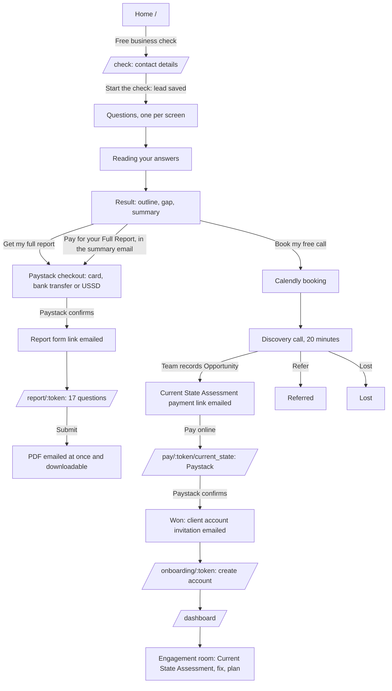
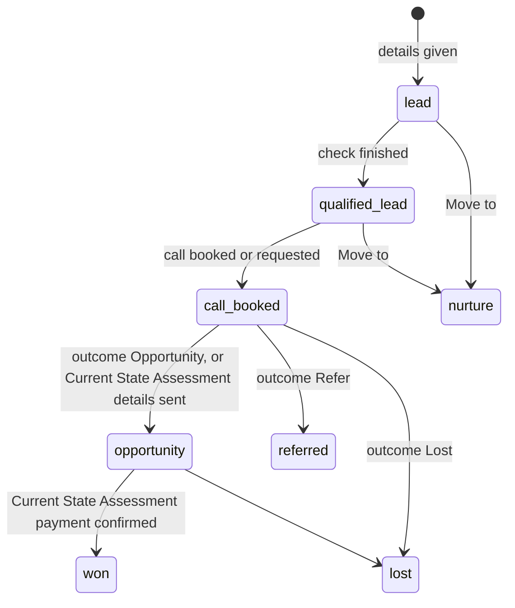
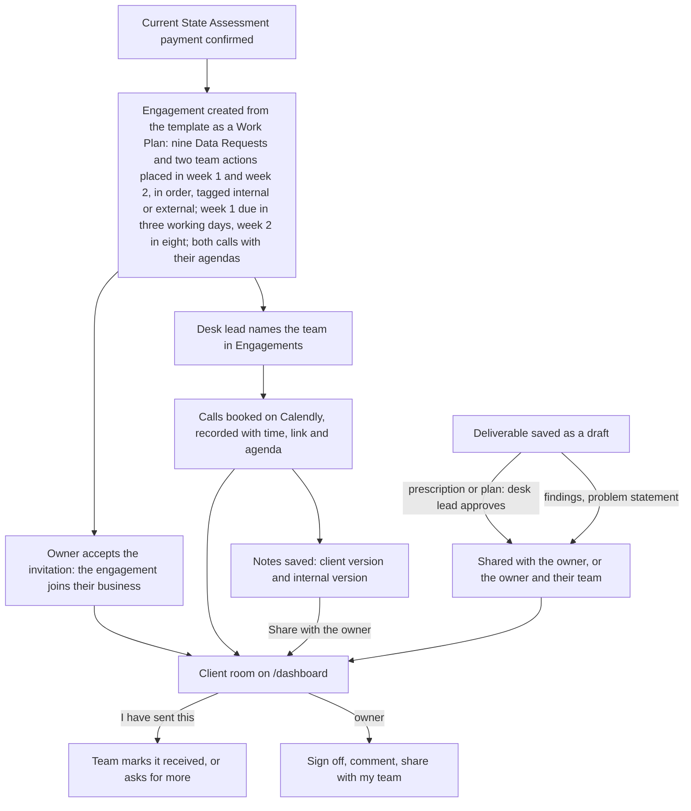

# 3. App flow

**What happens when someone clicks, and which page comes next.** Last reviewed 22 October 2026, against the code on the
working branch. Diagrams use Mermaid, which GitHub renders.

Every route listed in `client/src/App.tsx` appears in section 1. Every public page carries the same header (Services,
How we work, About, Questions, Contact, Client sign in and the free check; a menu button on phones) and footer
(`SITE_PAGES`, `client/src/components/SiteShell.tsx`), which also prints the office address. `test/docs/productDocs.test.ts` fails if a route is
added without being documented here.

---

## 1. Page map

### The Shift (current platform)

| Route | Page | Who can reach it | What it does | Next |
|---|---|---|---|---|
| `/` | `Home.tsx` | Anyone | The home page, problem-led since 6 November 2026 (a prospect's feedback; the page before is commit `0de5a75`): the hero ("Find it. Fix it. See the shift.", one line from today to the shift, the free check straight under it, the owners' words turning every five seconds), the problem with three sourced figures, "What problem are you facing right now?" with the fix under each problem (`NEED_LEAD`), how we fix it in three steps, why us (the record in four figures), three services most owners start with, the free check. The header keeps a short "Free check" button below 1,536 pixels wide and shows the full menu from 1,280 (the menu button below that, so a zoomed-in laptop never scrolls sideways) | A problem or a service → `/services/:slug`; "See all services" → `/services`; "How we work" → `/how-we-work`; "See our experience" → `/experience`; "Free Business Health Check" → `/check` |
| `/services` | `ServicesPage.tsx` | Anyone | The services, laid out as a store: one tile per product with a drawing of what it hands over, its promise and price (`shared/productStories.ts`), filtered by way to buy ("All" runs from the cheapest start to the dearest; a single way keeps the menu order); the free check for owners who are not sure; the three promises; work for a project team goes to Enzo Krypton & Co. | "Learn more" → `/services/:slug`; "Book a call" (Calendly) or "Start" → `/check` |
| `/services/:slug` | `ProductPage.tsx` | Anyone | One product: what it is, who it is for, what you get, what we need from you, the price and how it is paid, delivery and the refund promise, what usually comes next. A slug that is not on the menu says so and links the menu | "Book a free 20-minute call" (Calendly) for products that start with a call, and for every product until online ordering opens; "Take the free Business Health Check" for the check and the Full Report |
| `/how-we-work` | `HowWeWorkPage.tsx` | Anyone | The master consulting method (Enzo Operational Business Plan, slide 9): Define, Structure, Prioritise, Analyse, Synthesise, Recommend, Implement, each with what it produces and The Shift's stages on it, then the outcome standard (Day-30 Review) (`CONSULTING_METHOD` in `shared/method.ts`); the four ways to work with us, each product with its price and how that way is paid; the three promises; the ten places businesses get stuck | A product → `/services/:slug`; "See every service" → `/services`; questions → `/questions`; the free check → `/check` |
| `/experience` | `ExperiencePage.tsx` | Anyone | The record behind The Shift (moved off the home page, 6 November 2026): the track record and client logos, the experience behind The Shift, the research | The firm's site (new tab); the free check → `/check` |
| `/guides` | `GuidesPage.tsx` (`GuidesIndex`) | Anyone | Guides (6 November 2026): answers to what Nigerian owners search for, from Google's suggestions for Nigeria, one card each. Linked from the home page ("Owners also ask") and the footer | A guide → `/guides/:slug`; the free check → `/check` |
| `/guides/:slug` | `GuidesPage.tsx` | Anyone | One guide (`shared/guides.ts`): the owner's question as the headline and the search title, a plain answer in sections, "The fix, here" (the free check and the services that fix it, with prices from `shared/products.ts`), questions owners ask (FAQ structured data). Search titles for the home page and each service are in owners' words (`HOME_META`, `SERVICE_SEARCH_TITLES` in `shared/seo.ts`); the page headings do not change | The free check → `/check`; a service → `/services/:slug`; "Guides" → `/guides` |
| `/about` | `AboutPage.tsx` | Anyone | IP Factory and Enzo Krypton & Co., what we are and are not, who it is for, who you work with; a line to Experience | `/experience`; the free check → `/check` |
| `/questions` | `QuestionsPage.tsx` | Anyone | Every question in one place: before you buy, then each service's own questions in menu order, with a topic list | "More about …" → `/services/:slug`; "Talk to us" → `/contact`; the mailbox |
| `/contact` | `ContactPage.tsx` | Anyone | Book a free 20-minute call, write to the mailbox, the office (5 C&I Leasing Drive, Lekki Phase 1, shared with Enzo Krypton & Co.; `BRAND.officeAddress`), businesses across Nigeria, mostly online | Calendly (new tab); `mailto:`; Google Maps (new tab); "Client sign in" → `/login`; the free check → `/check` |
| `/check` | `BusinessCheck.tsx` | Anyone | The free Business Health Check, from contact details to the result, which names the first product to buy and the one after it (`shared/businessCheck/routing.ts`). The Start button says what is missing; focus moves to each new screen's heading; "Talk to us first" on the first step opens the calendar and scrolls it into view | Book a call (Calendly), ask for the Full Report, or open the first product's page |
| `/terms` | `LegalPage.tsx` | Anyone | The approved Terms & Conditions (`docs/legal/terms.md`, from the approved Word document), a plain reading page with no sign-in | Back to the site |
| `/privacy` | `LegalPage.tsx` | Anyone | The approved Privacy Policy (`docs/legal/privacy.md`, from the approved Word document), a plain reading page with no sign-in | Back to the site |
| `/report/:token` | `FullReportPage.tsx` | Link in the "payment received" email | The 17-question report form, then the download. Answers are kept on the device as the owner types (cleared once sent); sending with a gap takes the owner to that question | Report emailed; download on the page |
| `/pay/:token/:item` | `PayPage.tsx` | The "Pay online" button in a payment details email, or "Pay for your Full Report" in the Business Check summary email (Full Report only, before or after asking) (`:token` is the Business Check's token, `:item` is `full_report` or `current_state`) | The item, its amount from the payment request (₦100,000 or ₦500,000), "Pay ₦… securely with Paystack" (card, bank transfer or USSD on Paystack; no bank details on the site). "TEST MODE: NO REAL MONEY MOVES" while Paystack is on its test keys; "Already paid" once confirmed; no button while online payment is off or after the 48 hours | Paystack's checkout, then `/pay/return` |
| `/pay/return` | `PayReturnPage.tsx` | Paystack sends the owner back here with `?reference=` | Asks the server how the payment stands (section 4): "Payment received" with what happens next, "Still confirming" with "Check again", or "Payment not completed" with "Try again" (back to the pay page this tab came from) | — |
| `/onboarding/:token` | `OnboardingPage.tsx` | Link in the client account invitation | Create the client account | `/dashboard` |
| `/join/:token` | `JoinPage.tsx` | Link in a staff invitation or an owner's seat invitation | Set a password; staff land on `/admin` with their role, the owner's staff on `/dashboard` in that business | `/admin`, `/dashboard` |
| `/reset/:token` | `ResetPasswordPage.tsx` | Link in a password reset email, issued by the IP Factory team from Admin Team → People | Choose a new password; the link works once, for 20 minutes, and signs the person out everywhere | `/login` |
| `/login` | `LoginPage.tsx` | Anyone | Client sign-in with email and password: the brand and "Back to the site", show or hide the password, "Reset your password" in place; visitors who are not clients are pointed to the free check and the services | The landing page (section 6); `/`, `/check`, `/services`; programme participants to `/portal` |
| `/signup` | Redirect | Anyone | No public sign-up | `/login` |
| `/dashboard` | `AccountDashboard.tsx` | Signed-in account | The engagement room once the Current State Assessment is paid (section 9). A client with several projects (0018) sees **Your projects** at the top of the Overview and moves between them (`?project=ID` keeps the choice in the address; none opens the newest still open); each keeps its own Work Plan, Data Request, drop box and Deliverables, and a later project still shows the Business Health Check. A service project (Assessment, Done for You, Monthly Service) walks four steps read from its work: Records in, In progress, Delivered, Sign-off. **Agreement** (0019, once sent; the owner and full-access staff): what we will do, not included, what you do, the terms, a link to the Terms & Conditions, and the fees with due dates, paid or to pay, and the total; the owner ticks that they read it and types their full name to accept (it leads Next action until then); after acceptance it shows who accepted and when; while the team revises it, a line says it is being updated. **Fix the next problem**, under the Overview: ask your team for another service with a note (it reaches the desk and info@; nothing is charged in the room), what you have already asked for, and a link to every service and its price. as the room brief (document 07) describes: now (the stage, its week and day), the next action (one Data Request or Sign-off, with its button), the next Session with Join, the Engagement timeline numbered 1 to 7 (Business Check, Discovery Call, Full Report, Current State Assessment with the Work Plan by week, Findings, The Fix with the Measure of Success, Day-30 Review) with the current step open, the team and the owner's seat card. Before that: a welcome, when the room opens, and a prompt to finish the business profile. Staff: a link to the internal area | `/settings/business`, `/admin` |
| `/settings/business` | `BusinessSettingsPage.tsx` | Signed-in account (owners and business admins can save) | Business name, description, year founded, sector, website | — |
| `/settings/account` | `AccountSettingsPage.tsx` | Signed-in account | Name and password | — |
| `/admin/login` | `AdminLoginPage.tsx` | Staff | Staff sign-in with email and password | `/admin` |
| `/admin/reset` | `AdminPasswordResetPage.tsx` | Link in a reset email | Reset the administrator password | `/admin/login` |
| `/admin/invite` | `AdminInvitationPage.tsx` | Link in a staff invitation | Accept a staff invitation | `/admin` |
| `/admin` | `Admin.tsx` | Staff with a verified session | The admin console (section 7) | — |
| `/404`, anything else | `NotFound.tsx` | Anyone | Not found | `/` |

### JUMP-era pages still in the code

Kept for history and for JUMP participants. Nothing in The Shift's flow links to them, except the gap noted in section 10.

| Route | Page | What it is |
|---|---|---|
| `/admin/login/legacy` | `AdminLegacyLoginPage.tsx` | Old Google sign-in plus the JUMP administrator password; offered only where Manus OAuth is configured |
| `/portal` | `ParticipantDashboard.tsx` | JUMP participant portal: brief, Current State Assessment, payments with receipts, documents, sessions |
| `/portal/password` | `ParticipantPasswordPage.tsx` | Set a JUMP participant password |
| `/schedule` | `Schedule.tsx` | JUMP session booking (Decide, Learn, Apply) |

The server also redirects `/portal/authenticate` and `/portal/access` to `/?participant_signin=1` (`server/_core/app.ts`),
and receives Paystack's signed notifications at `POST /api/paystack/webhook` (section 4).

## 2. The journey, end to end

## 3. The free business check, screen by screen

Source: `client/src/pages/BusinessCheck.tsx`; rules in `shared/businessCheck/engine.ts`.

1. **Intro.** "Take the check". A returning owner sees "Continue where you left off" and "Start again". Progress is kept
   on the device (`localStorage` key `ipf-business-check-v1`) and saved to the server about once a second.
2. **Contact details** ("First, who are we talking to?"): full name, email, WhatsApp (optional, Nigeria by default),
   how they heard. "Start the check" calls `businessCheck.start`, which saves a **Lead**.
3. **Section intros.** Before each section: what it means and an example for the owner's sector.
4. **Questions,** one per screen, with a progress rail and the outline filling in on the side. The path depends on the
   answers (PRD F2). Typed answers (business name, one-line description) are required. Trading businesses end with
   **The problem to fix**: what they have tried (optional), what it costs each month, and who decides.
   "Back" and "Next" step through the questions in order, so every earlier answer can be opened and changed; after a
   change, "Next" moves to the following question, not past it. The phone's back gesture (and the browser's back
   button) does the same as "Back": one question back, never out of the check.
5. **Reading your answers** while `businessCheck.submit` runs. If it fails: "Try again".
6. **Result:** the tally (stuck, watch, clear), "What we found", "What we think it is", the outline with "Start here"
   and the greyed "Not assessed" areas, founder readiness in words, "Where we could help", and **Your next steps**.

On submit, the stage moves to **Qualified lead**; the owner is emailed their summary and the office gets a notice with
every answer.

## 4. From the result to a paid report

| Step | Who | What happens | Email | Stage or status |
|---|---|---|---|---|
| "Get my full report" | Owner | Opens Paystack's checkout straight away: `onlinePayment.start({ item: "full_report" })` files the request the first time (`askForFullReport`, `server/fullReportRequest.ts`) and returns Paystack's page. "Already paid" if it is | Owner: *Payment details for your Full Report* (the amount, the reference and a "Pay online" button, to come back to); office: *… asked for the Full Report* | Payment: **requested** |
| "Pay for your Full Report" in the summary email | Owner | The summary email links to `/pay/:token/full_report`. The page offers ₦100,000 before the owner has asked; pressing pay files the request exactly as "Get my full report" does, then opens Paystack. An expired Full Report link opens again with a new 48 hours. The Current State Assessment is never started from the owner's side | As for "Get my full report", once; office note: *Started paying online from the link in their Business Check summary email.* | Payment: **requested**, then paid as below |
| "Pay online" in the email | Owner | Opens `/pay/:token/full_report`; `onlinePayment.page` shows the item, the amount and the mode | — | — |
| "Pay ₦100,000 securely with Paystack" | Owner | `onlinePayment.start`: the server opens a Paystack transaction for the amount on the payment request, with its own reference (`TS-R-000123-1a2b3c4d`), and sends the owner to Paystack's checkout | — | — |
| Pays on Paystack | Owner | Paystack posts a signed `charge.success` to `/api/paystack/webhook` and sends the owner to `/pay/return`, which calls `onlinePayment.status`. Whichever comes first asks Paystack about the transaction again and, if the reference, status, currency and amount all match, confirms it through `confirmPayment`, with Paystack as the actor | Owner: *Payment received: your Full Report* (with the form link); office: *Paid online: …* | Payment: **paid**; report: **awaiting form** |
| "Confirm by hand" → "Yes, Paystack shows it paid" (fallback only) | Finance or Super Admin | `businessSupport.confirmPayment`, for a payment Paystack shows as paid that has not confirmed itself; the report link is issued in the same transaction, and two people confirming together confirm once | Owner: *Payment received: your Full Report* (with the form link) | Payment: **paid**; report: **awaiting form** |
| Form submitted | Owner | `fullReport.submit`; the report is built and rendered at once | Owner: *Your full business check report: {business}* (PDF attached); office: *Full report sent: {business}* | Report: **delivered** |
| "Send the form link again" | Finance or Super Admin | `businessSupport.resendReportLink`; the old link stops working; a confirmed payment with no link yet gets its first | Owner: *Your report form* | — |
| "Download the report" | Staff with `manage_client_onboarding` | `businessSupport.downloadReport` | — | — |

The form can be submitted once. After that the same link shows "Your report has been sent" with a download button.

**Paystack only, one confirmation.** Paystack is the only way to pay; its checkout takes card, bank transfer or USSD,
and there are no bank details and no proof of payment. The payment confirms itself through `confirmPayment`
(`server/payments.ts`), the path the team's "Confirm by hand" fallback uses too, so the emails, the Report Intake link,
the stage and the audit are the same. A Paystack confirmation is recorded with no person as the actor, the note "Paid
online with Paystack, reference …" ("TEST: " in front in test mode) and `via: "paystack"` in the audit; the stage
history shows "Paystack (paid online)". The same applies to the Current State Assessment payment in section 5.

**Online payment, in detail** (`server/onlinePayment.ts`, `server/paystack.ts`):

- **Off, test or live** from `PAYSTACK_SECRET_KEY`, which production requires (`/api/health` answers 503 without it):
  unset is off (nothing can be paid; `onlinePayment.start` refuses with "Online payment is not open yet…" and the
  emails say a link is coming), `sk_test_` is test (every pay page and payment email says "TEST MODE:
  NO REAL MONEY MOVES"), `sk_live_` is live.
- **The Current State Assessment link holds for 48 hours.** After that the pay page offers nothing and says to reply
  for a new link; the team sending it again opens it again. The Full Report link opens again by itself. A paid item
  shows "Already paid" and Paystack is not called.
- **Repeats and races confirm once.** A second webhook delivery, or the webhook and the return page together, send one
  owner email. A payment the team already confirmed by hand is left as it is.
- **What does not match is never confirmed.** A different amount or currency, a reference that is not the request's
  own, or a status other than success changes nothing. When money moved but does not match (wrong amount or currency,
  or an item already paid), the office gets *Paystack payment needs a look: …* and the audit records
  `payment_online_refused`; the return page shows "Still confirming" so the owner does not pay again.
- **Webhook answers:** 401 for a missing or wrong signature (nothing happens); 200 for every signed event handled or
  ignored; 500 only when Paystack or the database cannot be reached, so Paystack sends it again.

## 5. From the call to a client account

| Step | Who | What happens | Email | Stage |
|---|---|---|---|---|
| "Book my free call" | Owner | Calendly opens inline with name and email filled in. The call counts as booked only when Calendly confirms; "open in a new tab" also records the request. With no booking page, the button records a request | Office: *… asked for a free discovery call* (Calendly sends the owner its own confirmation) | **Call booked** |
| "Save the Discovery Call time" | Desk lead | Records the agreed time for any finished check, from Discovery Calls or the check's record. For an owner who booked from the link in the summary email or agreed a time another way it counts as the request. Calendly bookings are also picked up on each console load: for Discovery Calls asked for on the page, and for checks finished in the last 14 days | — | **Call booked** if earlier |
| "Record call outcome" | Desk lead | **Opportunity** (fit), **Refer** or **Lost** | — | **Opportunity**, **Referred** or **Lost** |
| "Move to" | Desk lead | Any other stage except **Won**, with a note (for example **Nurture**); Won comes only from a confirmed payment | — | As chosen |
| "Send the payment link" (Current State Assessment) | Finance or Super Admin | Payment request for ₦500,000 | Owner: *Payment details for your Current State Assessment* (the amount, the reference, the pay-by time and "Pay online") | Moves to **Opportunity** if earlier |
| "Pay ₦500,000 securely with Paystack" | Owner | As for the Full Report (section 4): `/pay/:token/current_state`, Paystack, then the webhook or `/pay/return` confirms through the shared path. The invitation is recorded against the person who sent the payment link, and audited with Paystack as the actor | Owner: *Payment received: your Current State Assessment starts* and *Set up your client account on The Shift*; office: *Paid online: …* (says whether the engagement started and the invitation went) | **Won** |
| "Confirm by hand" (fallback only) | Finance or Super Admin | For a payment Paystack shows as paid that has not confirmed itself: confirmed; an invitation is created unless one is pending or accepted; what happened to the confirmation email is recorded in the stage history | Owner: *Payment received: your Current State Assessment starts* and *Set up your client account on The Shift* | **Won** |
| "Send the confirmation again" | Finance or Super Admin | `businessSupport.resendPaymentConfirmation`: the "payment received" email again, for an owner who lost it (a paid Full Report gets its Report Intake link again instead) | Owner: *Payment received: your Current State Assessment starts* | — |
| "Create account" | Owner | `onboarding.accept`: person, credential, business, owner membership and session in one transaction | — | Invitation: **accepted** |

**The 48-hour window:** every payment details email says when to pay by, 48 hours after it was sent (Lagos time).
After that the payment shows "48 hours passed": the team sends the details again (a new window) or moves the business
to Lost. Nothing moves on its own, and money that still arrives can be confirmed.

**Relation to the locked flow in `Instruction.md`:** that flow goes Fit → onboarding invitation. The automatic
invitation follows the Current State Assessment payment instead (the concept note's pay-then-set-up order); a manual invitation
at Fit is still possible.

The desk lead can also send an invitation by hand from **Client Onboarding** ("Invite to onboard") and revoke a pending
one. Before the Current State Assessment payment is confirmed the server refuses the invitation unless a reason is
given; the reason is recorded in the audit log with the invitation.

## 6. Signing in and where people land

- **Clients** sign in at `/login`. **Staff** sign in at `/admin/login`.
- **Two-step sign-in** (staff, specialists and anyone with an internal role, on either page): after a correct password
  the page asks for the six-digit code from their authenticator app; nothing is signed in until the code is right.
  The first time, the page shows a QR code and the key to type in, "Turn on and sign in", then the eight recovery codes
  once ("I have saved them. Continue"). "Start again" goes back to the password. A recovery code works in the code box.
- Landing rule (`landingPathFor`, `shared/auth.ts`): a person with no business membership and at least one platform role
  goes to `/admin`; everyone else goes to `/dashboard`.
- `/dashboard` and the settings pages send a signed-out visitor to `/login`.
- **Invitation link while signed in as someone else:** the page names both email addresses and offers "Sign out and
  continue"; it never sends them to their own area or creates the account under their session. Signed in as the invited
  person: straight to `/dashboard`.
- **Invitation unavailable** (expired, used or revoked): "Invitation unavailable" with a link to `/login`.
- **Forgot your password?** (built 14 October) on both `/login` and `/admin/login`: the person types their email and
  "Send the reset link" emails a single-use link to `/reset/<link>`, valid for 20 minutes. The page always answers "If
  an account uses that email, we have sent it a link…", whether or not one does, and never shows the link. At most 5
  requests an hour per email and per address. A new link revokes the one still out. Suspended accounts and accounts
  without a password get nothing.
- **First password for the Super Admin:** for the address in `OWNER_ADMIN_EMAIL` the same form works even when the
  database has no account or password for the owner yet: it creates the owner's account and the email says "Set your
  password". Using the link sets the first password and stores the Super Admin role, so the owner can sign in at
  `/admin/login` without anyone running `pnpm owner:bootstrap`. Control of the owner's mailbox is the proof.

## 7. The admin console

`/admin` shows only the tabs a person's permissions allow (`client/src/lib/adminSections.ts`); the server checks every
action again.

| Tab | Permission | What it holds | Actions |
|---|---|---|---|
| **Business Checks** | `manage_client_onboarding` | Metrics (total, completed, call requested, ready to onboard, reports requested); stage filter; search; table with payment chips | Row → detail drawer: contact, the check, findings, outline, recommended support, funnel, **Payments** (send the payment link, confirm by hand as a fallback), **Full report** (resend link, download), **Move to** a stage, stage history, next step |
| **Discovery Calls** | `manage_client_onboarding` | Discovery Call requests and booked Discovery Calls | Schedule or reschedule the Discovery Call; **Discovery Call summary** (the guide's five parts: what we heard, the problem in the owner's words, what success looks like, what they tried, next steps), "Write up the Discovery Call" / "Save the Discovery Call", then "Share with the owner" or "Keep it internal" as a separate step (needs migration 0009); record the outcome (Opportunity, Refer, Lost); "Continue to Client Onboarding" |
| **Client Onboarding** | `manage_client_onboarding` | Metrics (checks, portal users, businesses, memberships, pending links); every check; invitations | "Invite to onboard" (a recorded reason is required before payment); copy the link once; revoke a pending invitation |
| **Engagements** | `view_all_businesses`, or `view_assigned_businesses` for the engagements a person is on | **Agreement and fees** in each engagement's record (0019): prefilled from the service (its promise, what you get, delivery and price; a Six-Week Fix in its three payments), edited and saved by anyone who works on the engagement, **Send to the owner** by its lead or the desk (the owner is emailed), **Revise** to change a sent or accepted one (the owner accepts the new version), and **Paid** on each fee line. **Clients asking for another service** (the desk, 0018): each request from a client's room with the service, who asked and their note; "Open the engagement" fills in the client, type and service, and marks the request done; "Decline". **New engagement** is for a new client or an existing one (an existing client's business: the project joins their account, nobody is invited); the types follow how the site sells (Business Review, Assessment, Done for You, Six-Week Fix, Monthly Service, Digital marketing), and a service type names the service, whose records and questions become the Data Request, with a Kick-off and a Handover. The Stage follows the type: a Business Review or Six-Week Fix moves through the method; any other type is Open or Closed. the line at the top and the empty list speak to every engagement type and to the viewer: the desk (`view_all_businesses`) reads that a Business Review starts when it is paid and any other type opens with New engagement; anyone else reads "The projects you are on" and, with none, "You are not on any project yet. When a lead adds you to one, it appears here and you get an email." (6 November 2026); a file storage line (uploads on, or exactly which Vercel setting or the private bucket is still missing); "Paid, but no engagement yet" (desk lead: a paid assessment with no engagement, with "Start engagement"); every engagement in scope: business, stage, team, what the client still owes (overdue in red), next call or calls not booked | **New engagement** (the desk: every engagement in view and `manage_engagements`): for a client who did not come through the Business Health Check, by type (Business Review, Digital marketing), business, client name and email, start date; the type's starting Work Plan, Data Request and Sessions are created, and the client's owner invitation link is shown once (an existing client account becomes the owner at once). Digital marketing rooms show the type's stages (Onboarding, Month 1, Month 1 review, Month 2, Month 3, Quarter review) dated from the start, and "Day N of 90". **My projects** first: a card for each engagement the person is on, with their role there, what is with the client, overdue, files to sort and the next Session. Row or card → drawer: the client, with **Send sign-in link** (`manage_client_onboarding`, built 14 October): a client with an account is emailed a password reset link, one without a fresh invitation (the one still out stops working; the payment rule still applies); the link shows once for WhatsApp; never a staff account or a suspended one; **Preview as client** (anyone who can open the engagement, built 6 November): the client's room full screen, exactly as the owner sees it, with every action off (no Sign-off, comment, sharing, upload, approval or download); Escape or Close preview returns to the record; each preview is logged (`engagement_room_previewed`); stage; team (`assign_engagements`: several people per engagement, each with a role; add lists only staff not already on it, a member's role changes on their own row, remove; the person is emailed when added or when their role changes, unless they made the change; only people with a staff account appear, so colleagues are first invited from Admin Team); the one problem; calls (time, link, agenda, client and internal notes, share with the owner or the owner and their team); the Work Plan (whose side, person, week, order, factor, due date, status, note); deliverables (save, approve: `review_engagements`, or the engagement's own Engagement Manager, Lead Consultant or Partner on that engagement only, `ENGAGEMENT_REVIEW_ROLES`; share, comment); files on requests and deliverables (open any; attach one as owner-only or for the owner and their team, when storage is set up); the fix (the one number with where it starts and should get to; one check-in a week, in order, with the five questions, the reading, hours by role and AI used). Changes need `manage_engagements` |
| **Clients** | `view_all_businesses` | Onboarded businesses and their members | Read only |
| **Admin Team** | Super Admin (`manage_roles`) | **Staff**: everyone at IP Factory with their **Level** (set or changed in place; never the system role behind it; a Super Admin reads "Super Admin"; no level yet reads "Level not set yet: choose one"), when their access ends, and invitations by level; then the legacy administrators. Their function on each project is set in Engagements | Invite by **level** (Partner, Vice President, Senior Associate: every engagement, assign and approve; Associate, Senior Business Analyst, Business Analyst: their engagements; Specialist: their engagements until an end date; Finance: payments only; `LEVEL_ROLES`), below your own (never Super Admin), copy the link once, revoke; the list shows when each person's access ends and roles that have ended; legacy: invite, revoke, edit powers People (`manage_users`): two tables, the IP Factory team (each person's **level**, which sets their title and access in one step, `manage_roles`; the function on a project is set per engagement) and Clients; everyone with a password, whether two-step sign-in is on, when access ends, a reset link emailed and shown once (people can also ask for their own from the sign-in page, §6), suspend with a recorded reason, reinstate, **Reset two-step** (lost phone), **Remove access** (asks for a reason; every role, engagement and session gone, account suspended, Super Admins told; never offered for a Super Admin) |
| **JUMP Programme (Legacy)** | `view_participants` | JUMP registrations, referrals, scheduling, replies | JUMP-era actions |

## 8. Status models

- The first three stages move automatically and only forward; they never overwrite a stage the team has set
  (`advancePipeline`, `shared/businessCheck/pipeline.ts`). The team can move a check to any stage except Won with "Move to";
  Won is set only by confirming the Current State Assessment payment.
- **Payment request:** requested → confirmed (`shared/payments.ts`; "proof received" survives only on records from before
  Paystack only). A request still awaiting payment 48 hours after the link went out shows as "48 hours passed" (worked
  out, not stored).
- **Full report:** awaiting form → delivered (`full_reports.status`).
- **Client invitation:** pending → accepted, revoked or expired (`client_onboarding_invitations`).

## 9. The engagement room

Built on 9 October for the Current State Assessment; live once migration 0008 is applied. The template (data requests, the six
pre-call questions, both call agendas and the findings outline) follows IP Factory's own assessment proposals, cut down
for two weeks and two calls (`shared/engagement.ts`, 10 October). The fix's measure and weekly
check-in screens come next (implementation plan, phase 4).

**The same frame for every client** (5 November, modelled on the IPF project-folder shell: each view answers one
question a client folder answers). Laid out like the approved prototype (Marcelle's room): the room fills the screen with its own left rail (the product, Home, My tasks, Files, the client's space with its views, and the account links), a white header (business / stage, the title, Day N of M with the logo-coloured bar, team avatars) and the views as tabs, in the order of the client's three questions: **Overview**; the work (**Work Plan · Data Request · Sessions**); what we found (**Business · Founder**, when a Business Check or Full Report is behind it); what they receive (**Deliverables**). The rail lists them in that order, grouped by spacing without headings; IP Factory's initials are always IPF,
(Business and Founder are for the owner and full-access staff only.) It opens on Overview: a dashboard first (a stage band across the seven steps, then four figures: stages complete, items outstanding with the client, overdue, and the next Session; each opens the view behind it), then the next action (for Data Requests, one card with the number outstanding and a link to the list) and the next meeting, then the timeline beside Waiting on you, Deliverables and
the team (each person's role on this engagement and firm title). Phones get a slim top bar instead of the rail.

- **List:** every task grouped Waiting on you / With IP Factory / Sent, we are checking / Done, with who owns it, a due
  flag ("Due in 2 days", "Due today", "Overdue by 3 days", "Done", in Lagos days) and the type. A task opens in a panel
  beside the list with its detail, files and the client's buttons (upload, mark as submitted or done). On a phone the
  owner and due flag sit under each title.
- **Schedule:** every Session in date order with a date tile, Held / Next / Booked / To be booked, the Join link
  before it and the notes once shared.
- **Content** (Digital marketing only, first in the work): the month's reels, posts and stories against the programme
  (15, 5 and 20 a month), counted once approved; a board of For your approval, In progress, Approved and Published by
  month; the owner and full-access staff approve or ask for changes with a note. The dashboard leads with the month's
  counts. The team adds and moves pieces in the engagement record's Content section.
- **Your team** (Overview): IP Factory first (name, role on the engagement, firm title), then the business's own people (name and Owner, Administrator, Full access or Contributor access; the viewer marked "you"), seen by everyone in the room.
- **The timeline's current step** shows the Work Plan as one line per item (number or tick, title, who, due date or
  status), grouped by week with "N of M done". A line opens the item in the List (`#task-N`), a Session in Schedule;
  the detail, buttons, agendas and Session notes live there, not in the timeline. Schedule folds each agenda and holds
  the owner's choice of who sees the notes.
- **Data requests:** shown only when there are any. Requested, received (a part-received item counts as half),
  outstanding and overdue above the Data Request itself: a checklist by section, open items first, each with its
  reference, status, due flag and priority, and, when opened, its purpose, format and files. The client answers an item
  by uploading, by "Not available" (with an optional note, which they can undo) or by "Submitted another way". Uploads
  go to one drop box beside the list: many files at once, in any order, without naming the item. The team matches each
  file to one or more items in the engagement record ("Files the client sent"); the client sees each file under
  "Documents received" with its match, or "Under review".
- **Documents:** the Full Report and every shared Deliverable, with comments and Sign-off.

A link to `#overview`, `#plan`, `#meetings`, `#data`, `#deliverables`, `#founder` or `#business` opens that view, and a
link into the timeline (`#step-5`) opens Overview first.

| The client clicks | What happens | Who can |
|---|---|---|
| A view (tab, or the left rail on a laptop), or swipes sideways on a phone | The view changes; a flick moves one view, a slow drag springs back. Arrow keys, Home and End move between tabs | Everyone who sees the room (Founder and Business: owner and full-access staff) |
| A line in **Waiting on you** or **Deliverables** (laptop and desktop only, beside the timeline) | Opens the timeline step that holds it: the Work Plan for a Data Request or action, the Findings, The Fix or Your Plan for a Deliverable, the Full Report step for the report | Everyone who sees the room; the owner's Sign-offs are listed for the owner only |
| An area on the Business tab | A sheet rises from below (a panel from the right on a laptop or desktop) with what the answers show, what it means, the Recommendation (First move, This week, Number to watch) and the benchmark bars. Drag it down, tap outside, press Escape or Close to dismiss; focus returns to the area. Areas with nothing more to show do not open | Owner and full-access staff, once the Full Report is delivered |
| "Upload a file" on a request | The browser sends the file straight to the private bucket with a one-off link, then the server records it and the request shows "Sent, we are checking"; a file that did not arrive is not recorded | Owner, full staff, and a contributor for their own requests; only when storage is set up |
| "Download" on a file | The server checks who is asking and issues a five-minute link | Whoever may see the item it sits on, or who uploaded it |
| "Mark as submitted" / "Sent another way" (with how they sent it), in the next action or on the Work Plan row | The Data Request shows "Sent, we are checking" for the client and the team | Owner, full staff, and a contributor for their own requests |
| "Mark as done" | The action is done | As above |
| "Sign off the Findings" (or the Prescription, or Your Plan) | The Deliverable shows Sign-off given for the team; audited. Until then it is the next action once nothing else is outstanding | Owner (and business admin) only |
| "Send" a comment | The comment shows under the deliverable for both sides | Anyone who can see the deliverable |
| "Share with my team" / "Keep this to myself" | The owner's staff with full access see it, or stop seeing it | Owner (and business admin) only |
| "Join the Session" | Opens the meeting link, from the next Session line or the Work Plan row | Anyone who sees the Session |
| "Book Current State Assessment Session 1" (then Session 2) | Opens the Session booking page on Calendly in a new tab with the owner's name and email filled in. When the room or the team's record next opens, the booking's time, length and meeting link are copied onto the next Session still without a time, in order (built 14 October; needs `CALENDLY_SESSION_URL` and `CALENDLY_API_TOKEN`) | Owner only; shown while a Session has no time |
| A step in the timeline | Opens that step: the Business Check's main finding and readiness; the Discovery Call once shared; the Full Report's delivery; the Work Plan by week with who (You, IP Factory, Together), when, status and the Session notes; the Findings and the Problem Statement; the Measure of Success week by week; Your Plan. The current step is open on load | Everyone who sees the room; the Discovery Call and the Problem Statement only the owner and full-access staff |
| The Measure of Success (no click: shown in The Fix once the team sets it) | This week's reading, large, in the health colour of its direction; where it started and where it is going; each week's reading with the next step; never the hours or the team's notes | Owner and full-access staff |
| "Invite" in Your team | Emails a single-use link (shown once when email is not set up); the seat counts as used | Owner (and business admin) only; one seat included |
| Change "What they can see" / "Remove" | Full or Contributor at once; Remove ends their access to the business straight away | Owner (and business admin) only |

## 10. Known gaps in today's flow

Found while writing this document. Each is small and listed in the implementation plan.

| Gap | Effect | Fix |
|---|---|---|
| ~~Home's "Client sign in" opens the JUMP participant sign-in~~ | Fixed 9 October: it goes to `/login`; JUMP participants reach their sign-in from `/portal` or the link on `/login` | Done |
| ~~Staff invitations use the legacy Google flow~~ | Fixed 9 October: Admin Team → Staff invites by email with one role; the person sets a password at `/join/:token` | Done (once migration 0008 is applied) |
| The `/admin` gate and side menu still say "Registration Desk" and Gmail | Old wording | Rebrand the labels |
| ~~"Invite to onboard" invites at any stage without a question~~ | Fixed 11 October: before Won the server requires a reason, which is recorded; "Move to" no longer offers Won | Done |
| The JUMP "Email selected" button opens nothing | Legacy only | Remove with the JUMP screens |

## Terms & Conditions and Privacy Policy (14 October 2026)

The approved wording lives in `docs/legal/` (the Word documents are the source of truth; `terms.md` and `privacy.md` are
faithful conversions that the site renders at `/terms` and `/privacy`). The links appear: in the home page footer; under
the contact details at the start of the Business Check ("By continuing, you agree to our Terms & Conditions and
acknowledge our Privacy Policy"); beside every button that sends the owner to Paystack (the result page and the pay
page: "By proceeding with payment, you agree…"); above "Create account" on `/onboarding/<token>` and `/join/<token>`;
as a quiet line on sign-in, password reset, the Full Report intake, the pay pages, the Business Check and the signed-in
pages; and in the footer of every Business Support email (absolute links on `APP_ORIGIN`). In the middle of a form or a
payment the links open in a new tab so nothing typed is lost. No consent is stored; there is no consent column.
