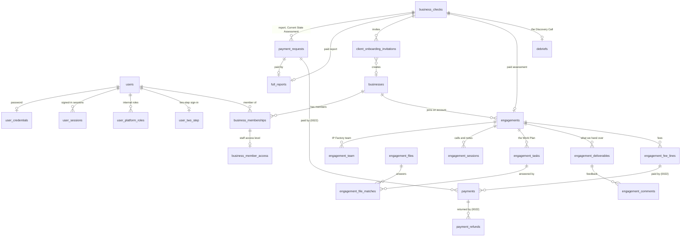

# 5. Backend schema: where client data lives and who can see it

Last reviewed 9 October 2026. The source of truth is `drizzle/schema.ts` (PostgreSQL on Supabase, through Drizzle);
this document explains it. `test/docs/productDocs.test.ts` fails if a table is added to the schema without appearing in
section 2 or 3.

**The model in one line:** a **person** (`users`) has one identity; they can belong to **businesses** through
**memberships** (client side) and hold **platform roles** (IP Factory side). A **business check** is the lead record
that payments, the full report and the client invitation hang off. The **engagement** starts when the Current State
Assessment is paid and joins the client's business when they create their account (section 2, migration 0008).

---

## 1. Conventions

- Every table has `id integer generated by default as identity` as its primary key.
- Timestamps are `timestamp with time zone`; `createdAt` defaults to now, and tables that change carry `updatedAt`.
- Tokens are stored as SHA-256 hashes, never in plain text, with one exception noted in section 6. Passwords use scrypt
  with a salt (`hashAdminPassword`, `server/adminSecurity.ts`).
- Enum values are stable identifiers. Labels shown to people come from shared code (`shared/payments.ts`,
  `shared/businessCheck/pipeline.ts`), so a label can change without a migration.
- Schema changes go through `drizzle/schema.ts` then `pnpm db:generate`; never by hand. Migrations `0000` to `0007` are
  applied to Supabase; `0008` (the engagement room) was applied on 10 October (`docs/database-migrations.md`).

## 2. Tables of The Shift (current platform)

### Identity and access

| Table | What it holds | Keys and rules | Personal or sensitive data |
|---|---|---|---|
| `users` | One identity per person: clients, staff and legacy OAuth users | Unique `openId`; unique `lower(email)`; `status` active, suspended or disabled; legacy `role` user or admin; `jobTitle` (0013: the firm title clients see beside the person's role on their engagement, set in People); `whatsapp` and `whatsappConsentAt` (0021: a staff member's WhatsApp number in international form, and when they agreed to it being shown; shown only once agreed, and only to the clients of their own engagements, R44) | Name, email, last sign-in, firm title, a staff member's WhatsApp number |
| `user_credentials` | A person's password | One per user; lockout after five failures for 15 minutes | Password hash |
| `user_sessions` | Server-side sessions behind the `ipf_session` cookie | Unique token hash; expiry; revocation; `activeBusinessId` (the workspace in use); `twoStepVerifiedAt` (0012: a person with an internal role is signed in only once it is set; until then the row is a ten-minute challenge); `deviceHash` (0012: a hash of browser and network, to notice a new device) | Token hash, device hash |
| `user_platform_roles` | Internal IP Factory roles (super_admin, admin, desk_lead, analyst, partner, subject_matter_expert, finance) | Unique (person, role); who granted it; `expiresAt` (0012: the role gives nothing after it; required for a specialist, at most 400 days ahead) | Who holds which role, until when |
| `user_two_step` | Two-step sign-in for one person (migration 0012) | One per user; the authenticator secret sealed with AES-256-GCM under a key derived from `JWT_SECRET`; recovery codes as SHA-256 hashes only; `lastUsedStep` so a code is never accepted twice; `enabledAt` empty until the first correct code | Sealed secret, recovery code hashes |
| `admin_permission_profiles` | Extra capabilities chosen by the Super Admin for a person | One per user | — |
| `admin_access_audit_events` | Append-only audit trail for staff, payments, reports, roles and onboarding | Written through `recordAudit` (`server/audit.ts`); details never contain secrets; indexed by action and time (0010). A system actor (Paystack confirming a payment) is a null `actorUserId` with `via` in the details, never an account | Actor id, target email |
| `user_password_reset_tokens` | Password reset links for client and staff accounts, issued by staff with `manage_users` or asked for by the person on a sign-in page (migration 0010) | Only the token's SHA-256; 20 minutes; single use; a new link revokes the one still out; who issued it (empty when the person asked); delivery status | Token hash |
| `rate_limit_counters` | Fixed-window counters behind the rate limits, shared by every function instance (migration 0010) | One row per key (`check_start:ip:…`, `check_submit:token:…`); window and count advance in one statement; expired rows are purged | Hashed keys only, no addresses in clear |

### Clients

| Table | What it holds | Keys and rules | Personal or sensitive data |
|---|---|---|---|
| `businesses` | A client's workspace | Unique slug; status active, suspended or archived | Name, description, sector, website, staff band, revenue band, location |
| `business_memberships` | Who belongs to which business, as owner, business_admin or member | Unique (business, person); only `active` grants access | Membership |

### The funnel: check, payments, report, invitation

| Table | What it holds | Keys and rules | Personal or sensitive data |
|---|---|---|---|
| `business_checks` | One free business check: contact, answers, result, summary, pipeline stage, call dates | Unique public token; stage from `PIPELINE_STAGES` | Name, email, WhatsApp, how they heard, business name and description, answers (including revenue band and what the problem costs each month) |
| `business_support_email_deliveries` | Metadata for important Business Support email attempts and their latest provider event | Resend message ID | Recipient and delivery metadata; no email body |
| `resend_email_events` | Deduplicated Resend webhook event metadata | Provider event ID | Event type, provider message ID, recipient and timestamps; no email body |
| `payment_requests` | A payment asked of the owner for the full report, or for a Business Review link sent before F3 (since F3 the Business Review is a fee on its engagement, App flow 3.2), paid on Paystack only | Unique reference (`TS-R-000123`, `TS-CS-000123`); one per check and item; status requested or confirmed (proof received survives only on records from before Paystack only), each move claimed in one conditional statement so a double click (or Paystack's webhook and the return page together) records it once; confirming a report payment issues its `full_reports` row in the same transaction. The 48-hour window runs from `requestedAt`, which resets when the details are sent again, so "48 hours passed" is worked out, not stored. Paystack charges `amountNaira` × 100 kobo, under a reference per attempt that starts with this row's (`TS-R-000123-1a2b3c4d`); no new column holds it (see below) | Amount, reference, the team's note (bank transaction reference). Proof arrives by email and is not stored |
| `full_reports` | The paid report: link, form answers, delivery | One per check; unique token hash; status awaiting_intake or delivered; `reportVersion` | **Financial figures**: revenue, costs, margin, prices, cash, money owed, loans, competitors |
| `client_onboarding_invitations` | The single-use link that creates a client account | Unique token hash; one pending per check; status pending, accepted, revoked, expired; expiry | Email, name and business name at the time |

The full report PDF is **not stored**: it is rebuilt from the stored form answers whenever it is emailed or downloaded,
so the same answers always give the same document.

**How an online payment is recorded** (no schema change). Paystack is a system actor, so a payment it confirms has
`confirmedByUserId` null and `note` "Paid online with Paystack, reference TS-R-000123-1a2b3c4d" ("TEST: " in front when
Paystack ran on its test keys). The `payment_confirmed` and `payment_confirmation_sent` audit rows have a null actor and
`via: "paystack"`, `paystackReference` and `mode` (`test` or `live`) in their details. The client account invitation it
sends needs a person in `client_onboarding_invitations.createdByUserId`: it is the team member who sent the payment
details, and the `client_onboarding_invitation_created` audit row keeps the null actor with `via` and
`recordedAgainstUserId`. A Paystack payment that moved money but could not be confirmed (another amount or currency, or
an item already paid) is recorded as `payment_online_refused`, with the problem, and the office is emailed. Nothing
Paystack sends is stored beyond this: no card details, no customer data.

### The engagement room (migration 0008)

Additive only: no existing table changes, so sign-in, onboarding and payments work on a database without these tables,
and the room says it is not set up. Vocabulary and the who-sees-what rules: `shared/engagement.ts`; the server side:
`server/engagements.ts`.

| Table | What it holds | Keys and rules | Personal or sensitive data |
|---|---|---|---|
| `engagements` | One per project (0020: `opensOnPayment`, set when an engagement is opened directly with fees, cleared by the first fee paid online or by hand, or by **Open the room now**; until then the client's room shows only the fee to pay); a client may have several over time (0018: a Business Review, then a Pitch Deck), listed in one room. The business check, the Current State Assessment payment, the business (once the owner has an account), stage, the one problem (area, sub-problem, statement), dates; its **type** (0016: Business Review, Digital marketing; 0018: Assessment, Done for You, Six-Week Fix, Monthly Service, following how the site sells), which sets the timeline and starting content; the **service** bought (0018, a product id), whose records and questions become the Data Request; for an engagement opened directly, no Business Health Check, with a start date and the client contact | Unique business check; for a Business Review since F3, opened when its link is sent, waiting for its first payment, with its two fees and the owner's name and email from the check as its contact, its plan loaded on the first payment (`server/businessReview.ts`); before F3, created by confirming the payment; linked by accepting the invitation, whichever comes second | The problem statement, in the owner's words |
| `engagement_team` | Who from IP Factory works on it, and in which role on this engagement: Engagement Manager (`manager`, 0013), Lead Consultant (`lead`), Analyst, Partner, Specialist (`expert`), and on a Digital marketing engagement only, Digital Marketer (`digital_marketer`) and Content Producer (`content_producer`) (0021, R45). Anyone may hold any role on a given engagement; their firm title is on `users` | Unique (engagement, person); only people with an internal role | Who works for which client |
| `engagement_sessions` | Sessions: kind, title, time, length, link, agenda, status, and their place in the Work Plan (`weekNumber`, `sortOrder`, 0009); the client's version of the notes and the internal notes | Notes reach the client only once shared, with an audience (`owner` by default) | **Session notes**: what the owner said on the call |
| `engagement_tasks` | The Work Plan: Data Requests and actions in one list: whose side, which person, due date, status (to do, sent, received, needs more, done), week and order in the week, and the factor tested (`internal` or `external`, 0009); for a Data Request (0014) its section and reference ("B Financial performance", "B1"), purpose (`informs`), format and priority (high, medium, low), and the status `not_available` when the client has no such record; `responseLink` (0021): a link to a shared folder that answers the item (footage, records), opened by the team; the file itself is never stored (R43) | A client-side task with no person belongs to the whole business | What the client was asked for |
| `debriefs` | The Discovery Call (0009): one per business check; held at; what we heard, the problem in the owner's words, what success looks like, what they tried, next steps; who captured it; shared at | Internal until `sharedAt` is set; the room shows it to the owner and full-access staff only, never who captured it | **The owner's own account of their business and problem** |
| `engagement_deliverables` | Findings, problem statement, prescription, tools, plan: status draft, awaiting approval, approved, shared; audience; the owner's sign-off | A prescription or plan cannot be shared before approval (review_engagements); editing a shared one takes it back to draft | **Findings** about the business and its people |
| `engagement_comments` | Feedback on a deliverable, from the client or the team | Only on a deliverable the writer can see | Comments |
| `engagement_files` | Files in private storage: the data request or deliverable they belong to, audience; a client upload to the drop box (0014) belongs to neither until matched, sits under `engagements/{id}/inbox/` and carries the client's note | Unique storage key under `engagements/{id}/tasks|deliverables/{id}/`; uploaded straight to a private Supabase bucket with a one-off signed URL, recorded only once the object exists; opened through five-minute signed links after the same access check (`server/fileStorage.ts`) | **Client files**: bank statements, accounts, staff lists |
| `engagement_file_matches` | Which Data Requests a file from the drop box answers (0014): file, task, who matched it, when | Primary key (file, task); only Data Requests of the file's own engagement; matching moves a waiting request to "Sent, we are checking" | Links between client files and requests |
| `engagement_content_items` | The content board of a Digital marketing engagement (0017): kind (reel, post, story), title, month, status (planned, in edit, for approval, changes requested, approved, published), due date, link, the client's note and approval | Only the team changes an item; only the owner or full-access staff approve or ask for changes, and only on an item waiting for approval; counted towards the month once approved | Client content and approvals |
| `service_requests` | "Fix the next problem" (0018): a client asks, from their room, for another service; the business, the engagement they were in, who asked, the service (a product id), their note, and open, done or declined | Anyone in the business asks, for their own business only; one open request per service; the desk (`view_all_businesses` and `manage_engagements`) lists and handles them; the desk is emailed | Who asked, their note |
| `engagement_agreements` | Retired (6 November 2026: there are no proposals or agreements on the platform). Kept from 0019 so nothing recorded is lost; nothing reads or writes it | — | Scope, terms and any typed name already recorded |
| `engagement_fee_lines` | The fees of an engagement (0019): label, amount in whole naira, due date, paid date, and (0020) the Paystack reference that paid it. Its reference is `TS-F-` and the id; its pay link carries an HMAC of the id (`server/feePayments.ts`) | Filled in when the engagement opens (`shared/agreement.ts`, `defaultFees`); changed with `manage_engagements`, in place (ids kept, a billed fee never removed); paid through the ledger (`payments`: Paystack, or Finance and the Super Admin by hand); read by those who work on or approve engagements and by `view_financials` (`canSeeFees`); shown to the owner and full-access staff on the room's Payments tab with each unpaid fee's pay link; never to a Specialist | Fees and payments |
| `engagement_measures` | The fix's one number: name, definition, unit, baseline, target | One per engagement (D3) | Business figures |
| `engagement_checkins` | One row per fix week: the five-question check-in, the reading, the questions asked and the hours by role (concept note §17) | Unique (engagement, week); week N is recorded only after week N-1 | The client sees the reading and the next step only; hours, blockers, questions and AI use stay with the team |
| `business_member_access` | The owner's staff: `full` or `contributor` | One per membership; no row means full (owners and business admins never have one) | — |
| `account_invitations` | Invitations that create an account for the owner of a business opened directly (`business_owner`, 0016), for IP Factory staff (with a role, or by level, `jobTitle`, 0015, which gives the level's roles and title) or the owner's staff (with an access level) | Token stored as a hash; single use, expiring, revocable; one pending per email. Staff: `manage_roles` invites, never Super Admin. Seats: the owner of the business in use, within `TEAM_SEATS_INCLUDED` | Email and name |

### The payments ledger (migration 0022, batch F: approved 10 November 2026; F1 built, applied with the ledger code)

What it does and who does it is in the App flow (section 3.1); the code that writes it is `server/ledger.ts`, the
only writer of the payments, the refunds, the counters and a fee's paid state and write-off (F1 and F2 built). Additive: three new tables and five columns on
`engagement_fee_lines`; nothing is dropped. It is applied just before the ledger code ships, not earlier: until then
Save the fees deletes and re-adds every fee, which the ledger's link from a payment to its fee refuses
(`docs/database-migrations.md`).

| Table | What it holds | Keys and rules | Personal or sensitive data |
|---|---|---|---|
| `payments` | One row per attempt to pay and per payment recorded by hand: the fee it pays, or the payment request (the Full Report until R13, and a Business Review link sent before F3); how it came (`paystack`, `bank_transfer`, `cash`, `other`); its status (`started`, `paid`, `failed`, `needs_a_look`, `refunded`, `cancelled`); the amount in whole naira (asked, for an attempt; received, once paid); the Paystack reference and mode (`test`, `live`); the day the money arrived and when it was confirmed or recorded; the receipt number; a note (the bank's reference, or why it needs a look); who recorded it (null for Paystack, a system actor); for a cancelled one, when, who and why | Exactly one of the fee and the payment request is set, and the amount is above nothing (checks `payments_one_owner`, `payments_amount_positive`); unique Paystack reference; unique receipt number (stored as a number, shown as `TS-RC-000001`); a status moves in one conditional statement (`started` to `paid` only where it is still `started`), so the webhook and the return page together record one payment and one receipt; only a payment recorded by hand is cancelled; never deleted; indexed by fee, by payment request and by status | Amounts, references, the team's notes |
| `payment_refunds` | Money returned against one payment: the amount, the day, the reason, Paystack's or the bank's reference, who recorded it; for one recorded by mistake, when, who and why it was cancelled | The amount is above nothing (`payment_refunds_amount_positive`); the refunds of a payment, less cancelled ones, never add up to more than it; refunded in full, the payment's status becomes `refunded`; never deleted | Reasons, references |
| `document_counters` | The last receipt number and the last invoice number given (`receipt`, `invoice`) | One row per kind, added the first time a number is given; a number is taken in the same transaction as the payment or fee it numbers, so numbers are unique, in order and without gaps (a save that fails gives its number back) | — |

New on `engagement_fee_lines`: `invoiceNumber` (unique, stored as a number and shown as `TS-IN-000001`, given the first
time the fee is billed and kept for good) and `writtenOffAmount`, `writtenOffAt`, `writtenOffByUserId` and `writeOffNote` (what was left when a
Partner or the Super Admin wrote it off, when, who and why; cleared when the write-off is reversed, which the audit log
records). `paidAt` stays and now means *paid in full*: set when the fee's payments, less refunds, reach its amount, and
cleared when a refund, a cancellation or a higher amount opens it again. Only the ledger writes it, in the same
transaction as the payment, holding a lock on the fee so two payments cannot both take what is left. `paidReference`
is retired from 0022 (kept so older rows read; the payments hold every reference). A fee's state follows from these:
written off, else paid, else late (dated and past), else due (dated), else set; part paid while something is paid.

**Saving the fees** keeps each fee's id: lines are updated in place, new ones added, and a removed one deleted only if
it was never billed (no invoice number and no payment). A fee's amount cannot go below what is paid on it.

**The backfill**, in 0022's own SQL: every fee marked paid becomes one paid payment for its amount (`paystack` with its
reference when it has one; otherwise `other`, noted "Marked paid before the ledger", and who ticked it stays in the
audit log); every confirmed payment request becomes one paid payment for its amount, with the Paystack reference from
its note and who confirmed it. Receipt numbers go to these in the order they were paid, invoice numbers to the paid fees
in the order they were set, and each counter is left at the last number given. Each statement skips what is already
there, so it can run again. Its guarded apply script is `drizzle/supabase/apply-0022-payments-ledger.sql`.

**Audit actions** (in the audit table below): `fee_payment_recorded`, `fee_payment_cancelled` and `payment_accepted`
(F1); `payment_refund_recorded`, `payment_refund_cancelled`, `fee_written_off` and `fee_write_off_reversed` (F2), each
with the fee or payment, the amount and the reason. `engagement_fee_paid` (the Paid tick) is retired and kept so older
rows read.

**Who sees it:** as for `engagement_fee_lines`, plus Finance (`view_financials`). Recording, cancelling, accepting and
refunds need `manage_payments`; write-offs a new permission, `write_off_fees`, for the Partner role (and the Super
Admin). The owner and full-access staff see each fee's state and what is left, and the receipt number, day and amount
of each payment and refund; never a cancelled one, a note or who recorded it. Never a Specialist. Finance's **Money in**
(F4) reads every payment that counts, with its refunds, the fee or payment request it is for, its receipt number,
Paystack reference and mode, its note and who recorded it, for `view_financials` only; its spreadsheet (CSV) is made in
the browser from what is on screen, so nothing leaves the server that Finance cannot already see.

### The audit log: every action it records

Each row of `admin_access_audit_events` names one of these actions (`AUDIT_ACTIONS` in `server/audit.ts`). Details hold
identifiers, amounts and field names, never passwords, tokens or links. A null actor is the platform itself (Paystack,
Calendly). `test/docs/productDocs.test.ts` fails if the server records an action that is not listed in `AUDIT_ACTIONS`,
or one listed there is missing here.

| Area | Actions | What each records |
|---|---|---|
| Signing in | `account_signed_in`, `account_signed_out`, `account_sign_in_failed`, `account_sign_in_locked`, `admin_sign_in_refused` | A sign-in (with two-step and new device), a sign-out, a wrong password and the count, a 15-minute lock, a staff sign-in refused |
| Two-step sign-in | `two_step_setup_started`, `two_step_challenge_issued`, `two_step_failed`, `two_step_enabled`, `two_step_recovery_code_used`, `two_step_reset` | Setting up the authenticator, asking for a code, a wrong code, turning it on, a recovery code used, a manager resetting it |
| The Super Admin's own access | `owner_credential_bootstrapped`, `owner_credential_reset`, `owner_password_enrolled`, `admin_password_reset_requested`, `admin_password_reset_completed` | The owner's password set up or reset, and the older administrator password reset |
| Passwords and profiles | `account_password_changed`, `account_password_reset_issued`, `account_password_reset_requested`, `account_password_reset_completed`, `account_profile_updated`, `business_profile_updated`, `workspace_switched` | A password changed; a reset link issued by a manager or asked for by the person, and used; a profile or business changed; the business in use switched |
| Accounts and roles | `account_suspended`, `account_reinstated`, `access_removed`, `platform_role_granted`, `platform_role_revoked`, `staff_level_set`, `staff_whatsapp_set` | An account suspended, reinstated or removed; a role given (with its end date) or taken away; a level set with the roles it gives; a staff WhatsApp number set by the person or a manager, and whether it is agreed (never the number) |
| Invitations and seats | `account_invitation_created`, `account_invitation_revoked`, `account_invitation_accepted`, `business_member_removed`, `client_onboarding_invitation_created`, `client_onboarding_invitation_revoked` | A staff, owner or seat invitation made, revoked or accepted; a seat removed; a client onboarding invitation made (with the reason when the payment is not yet confirmed) or revoked |
| Security | `security_alert` | A security email to the Super Admins: the event and how many received it |
| The funnel | `business_check_stage_changed`, `business_check_call_scheduled`, `business_check_call_booked`, `business_check_call_outcome`, `debrief_saved`, `debrief_shared` | A pipeline stage moved (from, to, note); a Discovery Call set by the desk or booked on Calendly; its outcome; the call summary saved and shared |
| Payment requests and the Full Report | `payment_details_sent`, `payment_confirmed`, `payment_confirmation_sent`, `payment_online_refused`, `full_report_link_sent`, `full_report_delivered` | Payment details sent; a payment confirmed (by hand or by Paystack); the receipt sent; an online payment refused (wrong amount, paid twice); the Report Intake link sent; the report delivered |
| Engagements | `engagement_started`, `engagement_stage_changed`, `engagement_room_previewed`, `engagement_room_opened`, `engagement_team_assigned`, `engagement_team_removed` | An engagement opened; its stage moved; Preview as client; the room opened before the first payment; a person added (with role) or taken off |
| Sessions and the Work Plan | `engagement_session_booked`, `engagement_notes_shared`, `engagement_audience_changed`, `engagement_data_request_loaded`, `engagement_task_answered` | A Session booked on Calendly; notes shared; the owner choosing who sees an item; a Data Request loaded; a request answered or marked not available |
| Files | `engagement_file_uploaded`, `engagement_file_shared`, `engagement_file_dropped`, `engagement_file_matched`, `engagement_file_removed` | A file uploaded to an item or a Deliverable; shared with the client; put in the drop box; matched to the requests it answers; removed by the client or by the team with its reason (the stored file deleted, R61) |
| Deliverables and content | `engagement_deliverable_approved`, `engagement_deliverable_shared`, `engagement_deliverable_accepted`, `engagement_content_saved`, `engagement_content_deleted`, `engagement_content_approved`, `engagement_content_changes_requested` | A Deliverable approved, shared or signed off; a content piece saved or deleted by the team, approved or sent back by the owner |
| The fix | `engagement_measure_saved`, `engagement_checkin_recorded` | The Measure of Success set; a Weekly Check-in recorded |
| More work | `service_requested`, `service_request_handled` | A client asking for another service; the desk handling or declining it |
| Fees | `engagement_fees_saved`, `engagement_fee_paid_online`, `engagement_fee_online_refused`, `engagement_fee_link_sent`, `engagement_fees_dated_on_delivery`, `fee_payment_recorded`, `fee_payment_cancelled`, `payment_accepted`, `payment_refund_recorded`, `payment_refund_cancelled`, `fee_written_off`, `fee_write_off_reversed` | The fee schedule saved (total, lines, any removed); paid on Paystack (the payment and its receipt number); an online payment that needs a look; a pay link sent; a service's second half dated seven days after its main output was shared (R36); money recorded by hand (amount, how, receipt number, what is left); a payment cancelled (the reason); a payment that needed a look accepted; a refund recorded or cancelled (amount, reason, reference); what was left of a fee written off (amount, note), and a write-off reversed (what it was, who, why) |
| Retired, kept so older rows still read | `payment_proof_received`, `engagement_agreement_saved`, `engagement_agreement_sent`, `engagement_agreement_revised`, `engagement_agreement_accepted`, `engagement_fee_paid` | Proof of payment uploads (before Paystack); proposals and their acceptance (removed 6 November 2026); the Paid tick (replaced by the ledger, F1). Nothing writes them now |

## 3. JUMP-era tables (legacy)

Kept so JUMP participants and history still work. The Shift's flow does not read or write them. Retire them only once
nothing reads them (implementation plan, phase 5).

| Area | Tables |
|---|---|
| Legacy staff sign-in (Google OAuth plus an administrator password) | `admin_credentials`, `admin_access_sessions`, `admin_password_reset_tokens`, `admin_invitations` (also read by the new sign-in to reserve invited emails) |
| JUMP applications and programme | `registrations`, `participant_programme_records`, `participant_programme_milestone_events`, `pricing_requests` |
| JUMP participant portal | `participant_auth_tokens`, `participant_credentials`, `participant_password_tokens`, `participant_portal_links` (unused), `participant_briefs`, `participant_engagement_consents`, `participant_assignments`, `participant_payment_receipts` |
| JUMP assessment | `current_status_assessments`, `consulting_chat_messages`, `consulting_reports` |
| JUMP referrals | `participant_referral_profiles`, `participant_referrals` |
| JUMP sessions | `schedule_slots`, `schedule_bookings`, `scheduled_reminder_deliveries` |
| JUMP email | `email_logs` (every row needs a registration), `inbound_email_replies` |

Note: The Shift records email delivery on its own rows (`deliveryStatus` on payments, invitations and reports), not in
`email_logs`.

## 4. Who can see what

### Roles and permissions

The catalogue lives in `shared/platformPermissions.ts` (`PLATFORM_PERMISSIONS`, `PLATFORM_ROLE_PERMISSIONS`). A person's
authority is the union of their roles, any profile the Super Admin set, and the legacy bridges (`resolveAuthority`).

| Role | Permissions today |
|---|---|
| super_admin | Everything |
| admin | Nothing by default (capabilities are granted one by one) |
| desk_lead | view_all_businesses, manage_engagements, assign_engagements, review_engagements, manage_scheduling, manage_communications, view_financials |
| analyst | view_assigned_businesses, manage_engagements |
| partner | view_assigned_businesses, review_engagements, view_financials, approve_work_before_payment, write_off_fees |
| subject_matter_expert | view_assigned_businesses, contribute_engagements |
| finance | manage_payments, view_financials |

With batch F (approved 10 November 2026, section 2): a fee payment by hand moved from `manage_engagements` (the Paid
tick) to `manage_payments` (F1); `write_off_fees`, for the partner role, writes off fees and reverses a write-off (F2).

**Privileged access (migration 0012).** Everyone with an internal role signs in with a password and a six-digit code
from an authenticator app. A role is given or removed only by someone whose own highest role ranks above it
(`PLATFORM_ROLE_RANK`: super_admin 100, admin 80, desk_lead and partner 60, finance 50, analyst 40,
subject_matter_expert 20), so only a Super Admin can make an Admin. A specialist's role ends on a date. **Remove access**
(People, `manage_users`) takes every role, engagement, session and the two-step set-up in one step, suspends the
account and records the reason. The Super Admins are emailed (and the audit log records `security_alert`) for a role
given, a staff invitation, a sign-in from a new device, a locked staff account, five wrong codes, a recovery code used,
a two-step reset and access removed. The controls against the NIST Cybersecurity Framework: `docs/security/nist-csf.md`.

Business membership roles (`shared/businessCapabilities.ts`): an **owner** can view, edit the profile, manage members,
invite and manage billing; a **business_admin** can view, edit and manage members; a **member** can view.

### Access matrix for The Shift's data

✅ allowed · ⚪ own records only · — no access. "Assigned" scope needs engagement assignments (section 5); until then no
procedure grants assigned-only access.

| Data | Prospect (token link) | Client (own business) | Analyst | Partner / SME | Desk lead | Finance | Super Admin |
|---|---|---|---|---|---|---|---|
| Their own business check, while taking it | ⚪ by the check's token | — | — | — | — | — | — |
| All business checks, pipeline, call outcomes | — | — | — (needs `manage_client_onboarding`) | — | ✅ if granted `manage_client_onboarding` | — | ✅ |
| Payment requests: send the link, confirm by hand (fallback) | — | — | — | — | — | ✅ `manage_payments` | ✅ |
| Pay page and return page: the item, its amount, the mode and whether it is paid; pay online | ⚪ by the check's token (pay page) or the Paystack reference (return page); nothing about the owner is returned | — | — | — | — | — | — |
| Full report form and download | ⚪ by the report token | — | — | — | ✅ download (`manage_client_onboarding`) | ✅ resend link | ✅ |
| Client invitations | ⚪ by the invitation token | — | — | — | ✅ `manage_client_onboarding` | — | ✅ |
| Business profile | — | ⚪ view; owner and business_admin edit | — | — | ✅ `view_all_businesses` (Clients tab) | — | ✅ |
| Roles and permissions | — | — | — | — | — | — | ✅ `manage_roles` |
| People: password reset links, suspend and reinstate | ⚪ the reset link, once | — | — | — | — | — | ✅ `manage_users` |
| Engagement room: the team's side | — | — | Assigned only (`view_assigned_businesses`); works on it (`manage_engagements`); Specialists hand in team items and IP Factory only drafts (`contribute_engagements`), no internal notes or fees | Assigned only; partners approve (`review_engagements`) | ✅ all; assigns the team, approves prescriptions and plans | — | ✅ |
| Engagement room: the client's side | — | ⚪ owner: everything shared; full staff: what the owner shares with them; contributors: their own requests and actions | — | — | — | — | — |
| Session notes and findings | — | ⚪ owner by default; the owner widens to their staff | ✅ when assigned | ✅ when assigned | ✅ | — | ✅ |
| Finance: every fee, payment, refund and write-off; Money in and its spreadsheet (F4) | — | — | — | Partner: ✅ sees (`view_financials`), writes off (`write_off_fees`); SME: — | ✅ sees (`view_financials`) | ✅ sees; records, cancels, accepts and refunds (`manage_payments`) | ✅ |

### How client isolation is enforced

`server/accountAuth.ts`:

- `resolveAccountSession` checks the session against the database on every call (hash, not revoked, not expired,
  person active).
- `loadMemberships` returns only active memberships in active businesses; `chooseActiveBusiness` keeps the stored
  workspace only while it is still a membership.
- `requireBusinessMembership` never trusts a business id sent by the browser; an unknown business and someone else's
  business get the same refusal.
- `requireBusinessCapability` adds the membership role check.
- A client's session never becomes a staff identity: the context builds a staff user only for a person with a platform
  role (`server/_core/context.ts`).

## 5. How the engagement room decides access

1. **The team: permission and assignment.** Seeing an engagement needs `view_all_businesses`, or
   `view_assigned_businesses` and a row in `engagement_team`. Changing it also needs `manage_engagements`;
   changing the team needs `assign_engagements`; approving a prescription or plan needs `review_engagements`. An
   engagement outside someone's scope and one that does not exist get the same "not available".
2. **The client: membership and audience.** The room shows the engagement of the business the person is working in;
   no client procedure accepts a business id. Each note, deliverable and file carries an audience: `team` (never
   leaves IP Factory), `owner` (default for notes and findings, because owners speak frankly on our calls) or
   `business` (the owner's staff with full access). Contributors see only the requests and actions given to them.
   Only owner-level people sign off or change an audience.
3. **"Shared" is stored** with who and when, and every share, approval, sign-off and audience change is in the audit
   trail, so "when did the client see this?" has an answer.
4. **Finance** sees payments, not engagements: no finance permission opens the room.

5. **Invitations** (`account_invitations`, `server/accountInvitations.ts`): a staff invitation creates the person with
   one role; a seat invitation creates the person with a membership and an access level, in the owner's business only,
   within the included seat. Accepting is one transaction; an existing account is never merged.

Still to build: the close and the day-30 check, which need an `engagement_closes` table (migration 0011, December).

## 6. Findings to fix

Found while writing this document.

| Finding | Risk | Fix |
|---|---|---|
| `business_checks.publicToken` is stored in plain text and works as a bearer token for that check | Someone with database read access could resume or submit another person's check | Store a hash, as every other token does; migrate existing rows |
| Full report links (`full_reports.tokenHash`) never expire and the report procedures have no rate limit | A forwarded link opens the report indefinitely | Add an expiry after delivery (or limit downloads) and a rate limit like onboarding's |
| ~~The 30 tables from the baseline migration have no foreign keys or indexes beyond primary and unique keys~~ | Migration 0010 (11 October) indexes `business_checks` (created, call requested, stage, `lower(email)`), the audit log (action, created), `user_sessions` (user, expiry), engagement comments, files and tasks. The JUMP-era tables keep no indexes | Done for The Shift's tables (0010 applied 12 October) |
| ~~No engagement assignment table~~ | Fixed by 0008: `engagement_team`; `view_assigned_businesses` now opens the engagements a person is on | Done (once 0008 is applied) |
| ~~`adminAccess.listTeam` lists only legacy admins~~ | Fixed 9 October: Admin Team now shows a Staff list from `user_platform_roles` above the legacy list | Done |
| `businessSupport.downloadReport` needs `manage_client_onboarding` while `resendReportLink` needs `manage_payments` | Finance can resend but not download | Decide which permission owns the report |
| `shared/auth.ts` and `docs/authentication.md` still say platform roles are "not built" and name a `platform_role_assignments` table | Misleading | Update the comments: the table is `user_platform_roles` |
| ~~File storage used the Manus "Forge" API~~ | The room now uses a private Supabase bucket (10 October); the Manus proxy remains only for the JUMP-era uploads | Done for the room; retire the proxy with the JUMP screens |
